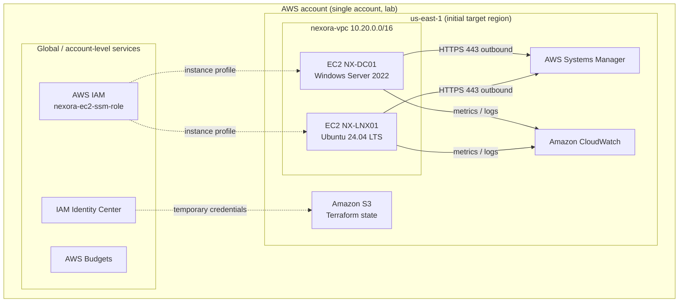
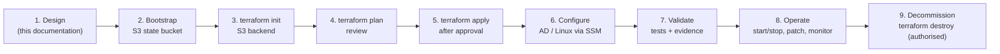

# AWS Architecture

| Field | Value |
|---|---|
| **Project** | Enterprise Systems Administration Lab (ESAL) |
| **Document** | AWS Architecture |
| **Version** | 1.0.0 |
| **Status** | DRAFT / PROPOSED |
| **Last updated** | 2026-11-22 |
| **Scope** | Account, region, VPC, EC2, IAM, Systems Manager, CloudWatch, S3, cost, availability, security, lifecycle |

> **Status:** Architecture **approved as design**, **NOT DEPLOYED**. No resource IDs exist yet.

---

## 1. Architecture Diagram



Related: [infrastructure-diagram.md](infrastructure-diagram.md) · [network-topology.md](network-topology.md) ·
[aws-design.md](../cloud/aws-design.md)

## 2. AWS Account Architecture

| Aspect | Decision | Status |
|---|---|---|
| Number of accounts | One account dedicated to the lab (or a clearly tagged scope in an existing account) | PROPOSED |
| Root user | MFA enabled, no access keys, not used for daily work | PLANNED |
| Human access | IAM Identity Center user with a permission set; temporary credentials via `aws sso login` | PROPOSED |
| Workload access | EC2 instance profile with an IAM role (no keys on servers) | PROPOSED |
| Tagging | `Project=ESAL`, `Environment=lab`, `Owner=<author>`, `ManagedBy=terraform` | PROPOSED |
| Cost guardrail | AWS Budgets alert (alert only, **not** a spending cap) | PLANNED |

A multi-account AWS Organizations structure is best practice for real enterprises, but adds
complexity disproportionate to a two-server lab. It is listed as a future improvement.

## 3. Region

| Item | Value |
|---|---|
| Initial target region | `us-east-1` (US East, N. Virginia) |
| Confirmation status | **VALIDATION REQUIRED** — confirm account availability, service availability, instance-type availability and pricing before deployment |
| Availability Zones used | One (proposed `us-east-1a`; the AZ name-to-ID mapping differs per account) |

The region is a Terraform variable so it can change without modifying resource code.

## 4. Amazon VPC

| Element | Value | Status |
|---|---|---|
| VPC | `nexora-vpc`, 10.20.0.0/16 | PROPOSED |
| Public subnet | `nexora-public-subnet-a`, 10.20.1.0/24 | PROPOSED |
| Private subnet | `nexora-private-subnet-a`, 10.20.2.0/24 | RESERVED — NOT DEPLOYED |
| Internet Gateway | `nexora-igw` | PROPOSED |
| Route table | `nexora-public-rt` | PROPOSED |
| Security Groups | `nexora-dc-sg`, `nexora-lnx-sg` | PROPOSED |
| DHCP option set | `nexora-dhcp-options` (after the DC is healthy) | PLANNED (Day 04) |
| NAT Gateway | Not used | Decision |
| VPC Interface Endpoints | Not used initially | Decision |

## 5. Amazon EC2

| Attribute | NX-DC01 | NX-LNX01 |
|---|---|---|
| Operating system | Windows Server 2022 Full (Desktop Experience) | Ubuntu Server 24.04 LTS |
| Image source | AWS-provided Windows AMI, resolved from an SSM public parameter | Canonical official AMI, resolved from an SSM public parameter |
| Sizing proposal | 2 vCPU / 4 GiB RAM | 2 vCPU / 2 GiB RAM |
| Candidate type | Burstable general purpose (e.g. `t3.medium`) — **VALIDATION REQUIRED** | Burstable general purpose (e.g. `t3.small`) — **VALIDATION REQUIRED** |
| Root volume | gp3, size to be validated (Windows needs more space for updates) | gp3, size to be validated |
| Private IP | Proposed 10.20.1.10 (static, assigned at launch) | Proposed 10.20.1.20 (static, assigned at launch) |
| Public IPv4 | Auto-assigned, dynamic, outbound use only | Auto-assigned, dynamic, outbound use only |
| Key pair | None planned (SSM-only access) | None planned |
| IMDS | IMDSv2 required (`http_tokens = "required"`) | IMDSv2 required |
| EBS encryption | Enabled | Enabled |

AMI lookup (no hard-coded AMI IDs):

```bash
aws ssm get-parameter --region us-east-1 \
  --name /aws/service/ami-windows-latest/Windows_Server-2022-English-Full-Base \
  --query Parameter.Value --output text

aws ssm get-parameter --region us-east-1 \
  --name /aws/service/canonical/ubuntu/server/24.04/stable/current/amd64/hvm/ebs-gp3/ami-id \
  --query Parameter.Value --output text
```

> The parameter paths above follow the published AWS and Canonical conventions and must be
> **validated** in the target account and region before use.

## 6. AWS IAM

| Identity | Type | Purpose | Status |
|---|---|---|---|
| Administrator (author) | IAM Identity Center user + permission set | Run Terraform and AWS CLI | PROPOSED |
| `nexora-ec2-ssm-role` | IAM role (trusted by `ec2.amazonaws.com`) | SSM Agent and CloudWatch agent permissions | PROPOSED |
| `nexora-ec2-ssm-profile` | Instance profile | Delivers the role to both instances | PROPOSED |

Attached AWS managed policies (proposed):

- `AmazonSSMManagedInstanceCore` — core Systems Manager functionality.
- `CloudWatchAgentServerPolicy` — publishing metrics and logs with the CloudWatch agent.

Details and policy examples: [iam-policies.md](../security/iam-policies.md).

## 7. AWS Systems Manager

Systems Manager is the **only** administrative access path:

- **Session Manager** — browser or CLI shell (PowerShell on Windows, Bash on Linux); port forwarding.
- **Fleet Manager** — console-based Remote Desktop to Windows instances.
- **Run Command** — run scripts on one or many instances.
- **Inventory** — software and configuration inventory (optional).

The SSM Agent initiates **outbound HTTPS (TCP 443)** connections to regional SSM endpoints.
Details: [systems-manager.md](../cloud/systems-manager.md).

## 8. Amazon CloudWatch

| Item | Proposal | Status |
|---|---|---|
| Default EC2 metrics | CPU, network, status checks (basic monitoring, 5-minute) | Available on launch |
| CloudWatch agent | Memory and disk metrics; selected logs | PLANNED (Day 06) |
| Log groups | e.g. `/nexora/windows/system`, `/nexora/linux/syslog`, `/nexora/linux/nginx` | PLANNED |
| Log retention | Short (e.g. 7–14 days) to control cost | PROPOSED |
| Alarms | Status-check failure, high CPU | PLANNED |

## 9. Amazon S3

One bucket for Terraform state only: `nexora-tfstate-<account-id>-us-east-1`.

| Control | Setting |
|---|---|
| Versioning | Enabled |
| Default encryption | SSE-S3 (or SSE-KMS) |
| Block Public Access | All four settings enabled |
| Bucket policy | Deny non-TLS requests |
| Locking | Terraform native S3 lock file (`use_lockfile = true`), **no DynamoDB** |

Details: [terraform-state.md](../cloud/terraform-state.md).

## 10. Cost Strategy

| Principle | Implementation |
|---|---|
| No NAT Gateway | Instances use dynamic public IPv4 for outbound traffic |
| No VPC Interface Endpoints initially | Avoid per-endpoint hourly charges |
| No permanent Elastic IPs | Instance public IPs are released when instances stop |
| Stop when idle | Start/stop routine; only EBS storage is billed while stopped |
| Minimal storage and logs | Right-sized gp3 volumes; short log retention |
| Visibility | Tags + Cost Explorer + AWS Budgets alerts |

Public IPv4 addresses are charged while assigned. AWS Budgets **alerts** on spend; it does not
stop resources or cap spending. Details: [cost-management.md](../cloud/cost-management.md).

## 11. Availability Considerations

| Aspect | Lab design | Production equivalent |
|---|---|---|
| Availability Zones | One | Two or more |
| Domain Controllers | One | At least two, in different AZs |
| Recovery | EBS snapshots / AMI (Day 07) | AWS Backup, multi-AZ, cross-region copies |
| DNS dependency | Single DC; AWS resolver kept as fallback | Multiple DCs as DNS servers |

These limitations are **intentional** to control cost and complexity and are documented as such.

## 12. Security Principles

1. No inbound administrative ports (22/3389) from the Internet.
2. Least privilege for human and workload identities.
3. Temporary credentials only; no long-lived keys in files or repositories.
4. Encryption at rest (EBS, S3) and in transit (HTTPS/TLS for AWS APIs and SSM).
5. Defense in depth: IAM → VPC → Security Group → host firewall → service configuration.
6. Auditability: CloudTrail (account default event history) and SSM session history.

See [security-baseline.md](../security/security-baseline.md).

## 13. Deployment Lifecycle



| Stage | Gate |
|---|---|
| Bootstrap | Budget alert configured; region confirmed |
| Apply | Plan reviewed; cost confirmed; explicit approval |
| Configure | Instances `Online` in Systems Manager |
| Decommission | Written authorisation; evidence collected; state backed up |

## References

- AWS — Regions and Availability Zones: <https://docs.aws.amazon.com/AWSEC2/latest/UserGuide/using-regions-availability-zones.html>
- AWS — Amazon EC2 instance types: <https://aws.amazon.com/ec2/instance-types/>
- AWS — Querying for the latest Windows AMI using Parameter Store: <https://docs.aws.amazon.com/systems-manager/latest/userguide/parameter-store-public-parameters-ami.html>
- AWS — Use IMDSv2: <https://docs.aws.amazon.com/AWSEC2/latest/UserGuide/configuring-instance-metadata-service.html>
- AWS — AmazonSSMManagedInstanceCore: <https://docs.aws.amazon.com/aws-managed-policy/latest/reference/AmazonSSMManagedInstanceCore.html>
- AWS — CloudWatch agent: <https://docs.aws.amazon.com/AmazonCloudWatch/latest/monitoring/Install-CloudWatch-Agent.html>
- AWS — Security best practices in IAM: <https://docs.aws.amazon.com/IAM/latest/UserGuide/best-practices.html>
- Canonical — Find Ubuntu images on AWS: <https://documentation.ubuntu.com/aws/aws-how-to/instances/find-ubuntu-images/>
- HashiCorp — S3 backend: <https://developer.hashicorp.com/terraform/language/backend/s3>
