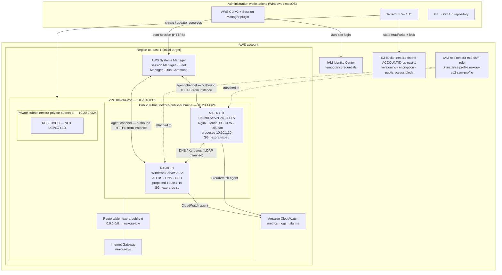

# Infrastructure Diagram — Complete Overview

| Field | Value |
|---|---|
| **Project** | Enterprise Systems Administration Lab (ESAL) |
| **Document** | Infrastructure Diagram |
| **Version** | 1.0.0 |
| **Status** | DRAFT / PROPOSED |
| **Last updated** | 2026-11-22 |
| **Scope** | End-to-end view of every planned component and how they relate |

> **Status:** All resources shown are **PROPOSED / NOT DEPLOYED**. IP addresses for the instances
> are **proposed allocations** pending implementation.

---

## 1. Purpose

This document is the single-page "map" of the lab. It shows which components exist, who manages
them, and which paths traffic and administration follow. Detailed design lives in
[aws-architecture.md](aws-architecture.md) and [network-topology.md](network-topology.md).

Diagram source: [`infrastructure/diagrams/aws-infrastructure-architecture.mmd`](../../infrastructure/diagrams/aws-infrastructure-architecture.mmd)

## 2. Architecture Diagram

## 3. Component Explanation

| Component | Proposed name | Purpose | Managed by |
|---|---|---|---|
| Administration workstations | — | Run AWS CLI, Terraform, Git, editors. Host **no** servers. | Author |
| IAM Identity Center | — | Issues short-lived credentials to the workstation user. | Console (manual) |
| S3 state bucket | `nexora-tfstate-<account-id>-us-east-1` | Stores Terraform state with versioning, encryption and native lock files. | Bootstrap (see [terraform-state.md](../cloud/terraform-state.md)) |
| VPC | `nexora-vpc` | Isolated network boundary, CIDR 10.20.0.0/16. | Terraform |
| Internet Gateway | `nexora-igw` | Gives the public subnet a path to the Internet for **outbound** traffic. | Terraform |
| Route table | `nexora-public-rt` | Sends non-local traffic (0.0.0.0/0) to the Internet Gateway. | Terraform |
| Public subnet | `nexora-public-subnet-a` | Hosts both EC2 instances (10.20.1.0/24). | Terraform |
| Private subnet | `nexora-private-subnet-a` | Reserved CIDR for future expansion. **Not provisioned.** | Documentation only |
| Security Groups | `nexora-dc-sg`, `nexora-lnx-sg` | Stateful instance firewalls; **no inbound administrative rules from the Internet**. | Terraform |
| NX-DC01 | EC2, Windows Server 2022 | Domain Controller for `nexora.local`: AD DS, DNS, Group Policy. | Terraform + PowerShell |
| NX-LNX01 | EC2, Ubuntu 24.04 LTS | Nginx web server, MariaDB database, Linux administration. | Terraform + Bash |
| IAM role + instance profile | `nexora-ec2-ssm-role`, `nexora-ec2-ssm-profile` | Lets the SSM Agent and CloudWatch agent call AWS APIs without stored keys. | Terraform |
| Systems Manager | — | Primary administration: shell sessions, remote desktop via Fleet Manager, Run Command. | AWS-managed |
| CloudWatch | — | Metrics, log groups and alarms for both instances. | Terraform + agents |

## 4. Server Roles

| Server | Role group | Services | Depends on |
|---|---|---|---|
| NX-DC01 | Identity & name resolution | AD DS, DNS Server, Group Policy, Windows DHCP role (**educational only**) | VPC, SG, IAM instance profile |
| NX-LNX01 | Application services | Nginx, MariaDB, UFW, Fail2ban | VPC, SG, IAM instance profile; NX-DC01 for domain DNS after Day 04 |

## 5. Connectivity Summary

| Path | Description | Inbound rule needed on instance SG? |
|---|---|---|
| Workstation → AWS APIs | Terraform and AWS CLI calls over HTTPS to public AWS endpoints | No |
| Workstation → instance shell | Session Manager; the SSM Agent keeps an **outbound** HTTPS channel | No |
| Instance → SSM / CloudWatch / updates | Outbound HTTPS through the Internet Gateway | No (outbound only) |
| NX-LNX01 → NX-DC01 | Domain services (DNS, Kerberos, LDAP) | Yes — **source = `nexora-lnx-sg`**, PLANNED for Day 04 |
| Internet → instances | Not permitted | — |

## 6. Terraform Management Boundary

| Managed by Terraform | Created outside the main Terraform configuration |
|---|---|
| VPC, subnet(s), IGW, route table | S3 state bucket (bootstrap configuration) |
| Security Groups and rules | IAM Identity Center users and permission sets |
| IAM role and instance profile | AWS Budgets (CLI or console) |
| EC2 instances | Active Directory content (PowerShell) |
| CloudWatch log groups and alarms | Linux service configuration (Bash) |

## 7. Validation (to be performed after deployment)

| Check | Command | Expected result | Status |
|---|---|---|---|
| Instances registered in SSM | `aws ssm describe-instance-information --query "InstanceInformationList[].[InstanceId,PingStatus,PlatformName]" --output table` | Two rows, `PingStatus = Online` | NOT TESTED |
| No public admin ports | See [security-groups.md](../networking/security-groups.md#8-validation-procedures) | Empty result | NOT TESTED |
| State in S3 | `aws s3 ls s3://<state-bucket>/` | State object present | NOT TESTED |

## References

- AWS — How Amazon VPC works: <https://docs.aws.amazon.com/vpc/latest/userguide/how-it-works.html>
- AWS — Internet gateways: <https://docs.aws.amazon.com/vpc/latest/userguide/VPC_Internet_Gateway.html>
- AWS — Session Manager prerequisites: <https://docs.aws.amazon.com/systems-manager/latest/userguide/session-manager-prerequisites.html>
- AWS — Amazon CloudWatch User Guide: <https://docs.aws.amazon.com/AmazonCloudWatch/latest/monitoring/WhatIsCloudWatch.html>
- HashiCorp — S3 backend: <https://developer.hashicorp.com/terraform/language/backend/s3>
- Mermaid — Flowchart syntax: <https://mermaid.js.org/syntax/flowchart.html>
