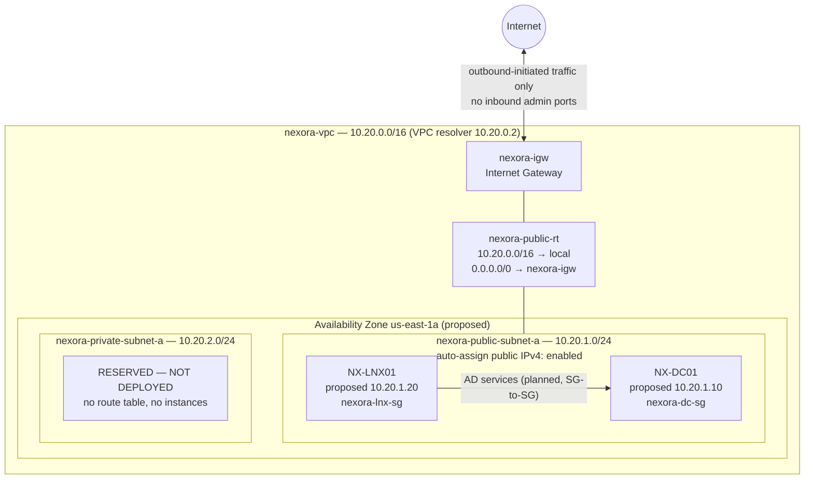

# Network Topology

| Field | Value |
|---|---|
| **Project** | Enterprise Systems Administration Lab (ESAL) |
| **Document** | Network Topology |
| **Version** | 1.0.0 |
| **Status** | DRAFT / PROPOSED |
| **Last updated** | 2026-11-22 |
| **Scope** | VPC layout, CIDRs, subnets, routing, Security Groups, internal and administrative traffic |

> **Status:** Network is **PROPOSED / NOT DEPLOYED**. Instance IPs are proposed allocations.

---

## 1. Topology Diagram

Diagram source: [`infrastructure/diagrams/network-topology.mmd`](../../infrastructure/diagrams/network-topology.mmd)



## 2. VPC

| Attribute | Value | Reason |
|---|---|---|
| Name | `nexora-vpc` | Project naming convention `nexora-<component>` |
| IPv4 CIDR | `10.20.0.0/16` | RFC 1918 private range; 65,536 addresses; avoids common home ranges |
| DNS resolution (`enableDnsSupport`) | `true` | Required for the Amazon-provided resolver |
| DNS hostnames (`enableDnsHostnames`) | `true` | Gives instances AWS internal DNS names |
| Tenancy | default | Dedicated tenancy is unnecessary and more expensive |
| IPv6 | Not used | Out of scope for the lab |

## 3. CIDR Ranges and Subnets

| Subnet | CIDR | Usable by EC2 | AZ | Route table | Status |
|---|---|---|---|---|---|
| `nexora-public-subnet-a` | 10.20.1.0/24 | 251 | us-east-1a (proposed) | `nexora-public-rt` | PROPOSED |
| `nexora-private-subnet-a` | 10.20.2.0/24 | 251 | us-east-1a (proposed) | — | RESERVED, NOT DEPLOYED |
| Unallocated | 10.20.3.0 – 10.20.255.255 | — | — | — | Future |

Calculations are in [ip-addressing.md](../networking/ip-addressing.md).

## 4. Internet Gateway

An Internet Gateway is a horizontally scaled, AWS-managed VPC component. It allows instances with
a public IPv4 address in a subnet routed to it to reach the Internet, and performs the 1:1
translation between private and public IPv4 addresses.

In this design the gateway is required for **outbound** traffic only: Systems Manager, CloudWatch,
Windows Update and Ubuntu package repositories. Security Groups ensure that no unsolicited inbound
connection reaches the instances.

## 5. Route Tables

| Route table | Destination | Target | Purpose |
|---|---|---|---|
| `nexora-public-rt` | 10.20.0.0/16 | local | Intra-VPC traffic (implicit, cannot be removed) |
| `nexora-public-rt` | 0.0.0.0/0 | `nexora-igw` | Outbound Internet access |
| Main route table | 10.20.0.0/16 | local | Default for unassociated subnets; no Internet route |

The private subnet, when created in a future phase, would use a separate route table **without**
an Internet Gateway route (and, if needed, a route to a NAT Gateway or VPC endpoints).

## 6. Security Groups

| Security Group | Attached to | Inbound (summary) | Outbound |
|---|---|---|---|
| `nexora-dc-sg` | NX-DC01 | AD/DNS ports **from `nexora-lnx-sg` only** (PLANNED) | All (required for SSM, updates) |
| `nexora-lnx-sg` | NX-LNX01 | Optional HTTP 80 **from `nexora-dc-sg` only** (PLANNED) | All |

Full matrix: [security-groups.md](../networking/security-groups.md).

## 7. Server Connectivity

| Flow | Source | Destination | Protocol / port | Status |
|---|---|---|---|---|
| Domain DNS | NX-LNX01 | NX-DC01 | UDP/TCP 53 | PLANNED (Day 04) |
| Kerberos | NX-LNX01 | NX-DC01 | UDP/TCP 88 | PLANNED (future domain join) |
| LDAP | NX-LNX01 | NX-DC01 | TCP/UDP 389 | PLANNED (future domain join) |
| Web test | NX-DC01 | NX-LNX01 | TCP 80 | PLANNED (Day 04) |
| MariaDB | localhost | NX-LNX01 | TCP 3306 bound to 127.0.0.1 | PLANNED — **no SG rule** |

## 8. Administrative Access

| Method | How it works | Inbound port on SG |
|---|---|---|
| Session Manager (shell) | Workstation → SSM service ← outbound channel from SSM Agent | None |
| Session Manager port forwarding | Forwards a local workstation port to a port on the instance through the agent channel | None |
| Fleet Manager Remote Desktop (Windows) | Browser-based RDP from the Systems Manager console | None |
| SSH (22) / RDP (3389) from the Internet | **Not permitted** | — |

See [systems-manager.md](../cloud/systems-manager.md).

## 9. Network Security Boundaries

```text
Boundary 1 — AWS account (IAM)          : who may change or reach anything
Boundary 2 — VPC                         : isolated address space 10.20.0.0/16
Boundary 3 — Route tables                : which subnets can reach the Internet
Boundary 4 — Security Groups (stateful)  : per-instance allow-lists
Boundary 5 — Host firewall               : Windows Defender Firewall / UFW
Boundary 6 — Service configuration       : e.g. MariaDB bound to 127.0.0.1
```

Network ACLs remain at their default (allow all) because Security Groups already provide
stateful, instance-level filtering. Custom NACLs are a possible Day 04 exercise.

## 10. Validation (post-deployment)

```bash
# VPC and subnets
aws ec2 describe-vpcs --filters Name=tag:Name,Values=nexora-vpc \
  --query "Vpcs[].[VpcId,CidrBlock]" --output table
aws ec2 describe-subnets --filters Name=tag:Project,Values=ESAL \
  --query "Subnets[].[Tags[?Key=='Name']|[0].Value,CidrBlock,AvailabilityZone,MapPublicIpOnLaunch]" --output table

# Routes of the public route table
aws ec2 describe-route-tables --filters Name=tag:Name,Values=nexora-public-rt \
  --query "RouteTables[].Routes[]" --output table
```

| Check | Expected | Status |
|---|---|---|
| VPC CIDR | 10.20.0.0/16 | NOT TESTED |
| Only the public subnet exists | One subnet, 10.20.1.0/24 | NOT TESTED |
| Default route | 0.0.0.0/0 → igw-… | NOT TESTED |

## References

- AWS — VPC CIDR blocks: <https://docs.aws.amazon.com/vpc/latest/userguide/vpc-cidr-blocks.html>
- AWS — Subnets for your VPC: <https://docs.aws.amazon.com/vpc/latest/userguide/configure-subnets.html>
- AWS — Route tables: <https://docs.aws.amazon.com/vpc/latest/userguide/VPC_Route_Tables.html>
- AWS — Internet gateways: <https://docs.aws.amazon.com/vpc/latest/userguide/VPC_Internet_Gateway.html>
- AWS — Network ACLs: <https://docs.aws.amazon.com/vpc/latest/userguide/vpc-network-acls.html>
- IETF — RFC 1918, Address Allocation for Private Internets: <https://www.rfc-editor.org/rfc/rfc1918>
