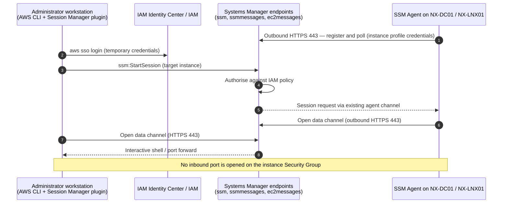

# AWS Systems Manager

| Field | Value |
|---|---|
| **Project** | Enterprise Systems Administration Lab (ESAL) |
| **Document** | AWS Systems Manager |
| **Version** | 1.0.0 |
| **Status** | DRAFT / PROPOSED |
| **Last updated** | 2026-11-22 |
| **Scope** | Session Manager, Fleet Manager, SSM Agent, IAM, connectivity, Windows/Linux administration, troubleshooting |

> **Status:** Systems Manager has **NOT been configured or tested**. Nothing in this document
> describes an observed result.

---

## 1. Overview

AWS Systems Manager (SSM) is a collection of tools for operating EC2 instances and other managed
nodes. In this project it is the **primary and only** administrative access path.

| Tool | Use in ESAL | Phase |
|---|---|---|
| Session Manager | Interactive shell (PowerShell / Bash); port forwarding | Day 02 onwards |
| Fleet Manager | Console-based Remote Desktop to NX-DC01; node overview | Day 02 onwards |
| Run Command | Execute scripts on one or both instances | Day 02–06 |
| Inventory | Software / configuration inventory | Optional (Day 06) |
| Patch Manager | Patching | Optional (Day 06–07) |
| Parameter Store | Non-secret configuration; SecureString for secrets if needed | Optional |

Diagram source: [`infrastructure/diagrams/systems-manager-access-flow.mmd`](../../infrastructure/diagrams/systems-manager-access-flow.mmd)



## 2. Session Manager

| Capability | Detail |
|---|---|
| Shell access | PowerShell on Windows, `sh`/`bash` on Linux, from the console or AWS CLI |
| Port forwarding | `AWS-StartPortForwardingSession` — e.g. local 8080 → NX-LNX01:80 |
| Remote host forwarding | `AWS-StartPortForwardingSessionToRemoteHost` — via an instance to another host |
| Auditing | Session history; optional session logging to CloudWatch Logs or S3 |
| Access control | IAM policies (who, which instance, which document) |

Illustrative commands (**not executed**):

```bash
# Shell
aws ssm start-session --target <instance-id> --profile esal

# Port forwarding: browse Nginx at http://localhost:8080
aws ssm start-session --target <nx-lnx01-instance-id> \
  --document-name AWS-StartPortForwardingSession \
  --parameters '{"portNumber":["80"],"localPortNumber":["8080"]}' --profile esal

# Port forwarding for a local RDP client (alternative to Fleet Manager)
aws ssm start-session --target <nx-dc01-instance-id> \
  --document-name AWS-StartPortForwardingSession \
  --parameters '{"portNumber":["3389"],"localPortNumber":["13389"]}' --profile esal
```

The CLI requires the **Session Manager plugin** installed on the workstation.

## 3. Fleet Manager

Fleet Manager provides a console view of managed nodes and **Remote Desktop to Windows instances
directly from the Systems Manager console**, without exposing TCP 3389. The remote desktop is
console-only (no command-line connection) and supports up to four simultaneous connections in one
browser window.

| Requirement | Note |
|---|---|
| Instance is a managed node | SSM Agent online with correct instance profile |
| Additional IAM permissions for the user | Fleet Manager / GUI Connect permissions — VALIDATION REQUIRED against AWS docs |
| Windows credentials | A domain account (on a DC there are no local accounts after promotion) |

## 4. SSM Agent

| Item | Windows Server 2022 AMI | Ubuntu 24.04 AMI |
|---|---|---|
| Pre-installed | Yes (AWS Windows AMIs) — VALIDATION REQUIRED | Yes, as a snap on official Canonical AMIs — VALIDATION REQUIRED |
| Service name | `AmazonSSMAgent` | `snap.amazon-ssm-agent.amazon-ssm-agent` |
| Install path | `%PROGRAMFILES%\Amazon\SSM\` | `/snap/amazon-ssm-agent/` |
| Logs | `%PROGRAMDATA%\Amazon\SSM\Logs\` | `/var/log/amazon/ssm/` |

From agent version 2.3.50.0, the agent creates a local `ssm-user` account and adds it to
`/etc/sudoers.d` on Linux or to the Administrators group on Windows Server.

## 5. IAM Permissions

| Side | Permission | Provided by |
|---|---|---|
| Instance (agent) | Register, receive commands, open channels | `AmazonSSMManagedInstanceCore` on `nexora-ec2-ssm-role` |
| Instance (CloudWatch agent) | Publish metrics/logs | `CloudWatchAgentServerPolicy` |
| Administrator | `ssm:StartSession`, `ssm:TerminateSession`, describe actions | Identity Center permission set (scoped example in [iam-policies.md](../security/iam-policies.md#103-session-manager-limited-to-esal-tagged-instances)) |

## 6. EC2 Instance Profile

| Resource | Proposed name |
|---|---|
| Role | `nexora-ec2-ssm-role` (trusts `ec2.amazonaws.com`) |
| Instance profile | `nexora-ec2-ssm-profile` |

Without an instance profile with the right permissions, the instance never appears as a managed
node — the most common setup error.

## 7. Required Outbound HTTPS Connectivity

The managed node must allow **outbound HTTPS (TCP 443)** to these regional endpoints:

| Endpoint | Purpose |
|---|---|
| `ssm.us-east-1.amazonaws.com` | Systems Manager API |
| `ssmmessages.us-east-1.amazonaws.com` | Session Manager data channel |
| `ec2messages.us-east-1.amazonaws.com` | Agent messaging (Run Command, etc.) |
| `logs.us-east-1.amazonaws.com` | Only if session logs / CloudWatch agent logs are sent |
| `s3.us-east-1.amazonaws.com` | Only if session logs go to S3 or agent updates are downloaded from S3 |

In this design these are reached through the **public IPv4 address + Internet Gateway**. A
private-subnet design would instead need a NAT Gateway or VPC interface endpoints for each service
(cost trade-off: [cost-management.md](cost-management.md)).

## 8. Domain Controller Consideration: ssm-user

From SSM Agent version 2.3.612.0, the `ssm-user` account **is not created automatically** on
Windows Server machines used as domain controllers. To use Session Manager on a domain
controller, AWS instructs creating the `ssm-user` account manually (if not present) and assigning
it Domain Administrator permissions. On Windows Server, the agent sets a new password for
`ssm-user` each time a session starts, so no password needs to be specified when creating the account.

| Implication | Project handling | Status |
|---|---|---|
| Session Manager may fail after promotion | Plan the `ssm-user` step in the Day 02 runbook immediately after promotion | PLANNED |
| `ssm-user` becomes a highly privileged **domain** account | Document it, monitor its group membership, restrict who may start sessions on NX-DC01 | PLANNED |
| Behaviour depends on agent version and AWS documentation | Re-check the documentation and installed agent version before Day 02 | **VALIDATION REQUIRED** |
| Fallback access | Fleet Manager Remote Desktop with a domain admin account; EC2 Serial Console (if enabled) | PLANNED |

## 9. Windows Administration via SSM

| Task | Method |
|---|---|
| PowerShell administration | Session Manager shell |
| GUI tools (ADUC, GPMC, DNS Manager) | Fleet Manager Remote Desktop |
| Script execution at scale | Run Command `AWS-RunPowerShellScript` |
| File transfer | Small scripts via Run Command / S3 download from the instance — VALIDATION REQUIRED |

## 10. Linux Administration via SSM

| Task | Method |
|---|---|
| Shell | Session Manager (`sudo -i` when needed) |
| Web test from workstation | Port forwarding 80 → localhost:8080 |
| Script execution | Run Command `AWS-RunShellScript` |
| Run sessions as a named user | Session Manager *Run As* preference (optional) |

## 11. No Inbound SSH/RDP Design

| Traditional design | ESAL design |
|---|---|
| Open 22/3389 to an IP range | No inbound administrative rule at all |
| Manage SSH keys / RDP passwords for access | IAM-controlled sessions; no key pair |
| Bastion host | Not needed |
| Access logs on each server | Central session history + CloudTrail |

## 12. Troubleshooting

| Symptom | Likely cause | Check |
|---|---|---|
| Instance not listed in Fleet Manager | Missing/incorrect instance profile | `aws ec2 describe-iam-instance-profile-associations` |
| Instance `ConnectionLost` | No outbound 443 / no public IP / no IGW route / DNS failure | Route table, SG egress, `Resolve-DnsName ssm.us-east-1.amazonaws.com` |
| `TargetNotConnected` | Agent stopped or not registered | EC2 Serial Console / Run Command history; agent logs |
| `start-session` fails locally | Session Manager plugin missing | `session-manager-plugin --version` |
| "Failed to create user ssm-user" on DC | DC behaviour (§8) | Create `ssm-user` per AWS documentation |
| Session works but `AccessDenied` on actions | User IAM policy too narrow | CloudTrail `errorCode` |

```bash
aws ssm describe-instance-information \
  --query "InstanceInformationList[].[InstanceId,PingStatus,AgentVersion,PlatformName]" --output table
aws ssm get-connection-status --target <instance-id>
```

## 13. Security Benefits

- No listening administrative ports exposed to the Internet.
- Access governed and audited by IAM and CloudTrail.
- No SSH keys or RDP passwords to distribute for access.
- Sessions can be logged centrally.
- Access can be revoked instantly by changing IAM policy.

## 14. Operational Limitations

| Limitation | Impact |
|---|---|
| Depends on outbound Internet + DNS | If either breaks, access breaks; keep the AWS resolver reachable |
| `ssm-user` on DCs requires manual handling | Extra privileged domain account |
| Fleet Manager Remote Desktop is console-only, max 4 sessions per browser window | Not an issue for a two-server lab |
| Port forwarding requires the plugin on each workstation | Install on both Windows and macOS |
| Session idle timeout | Long-running interactive work may disconnect; adjust preferences |

## References

- AWS — Session Manager prerequisites: <https://docs.aws.amazon.com/systems-manager/latest/userguide/session-manager-prerequisites.html>
- AWS — Technical details about SSM Agent (ssm-user): <https://docs.aws.amazon.com/systems-manager/latest/userguide/ssm-agent-technical-details.html>
- AWS — Fleet Manager Remote Desktop: <https://docs.aws.amazon.com/systems-manager/latest/userguide/fleet-manager-remote-desktop-connections.html>
- AWS — Install the Session Manager plugin for the AWS CLI: <https://docs.aws.amazon.com/systems-manager/latest/userguide/session-manager-working-with-install-plugin.html>
- AWS — Start a session (port forwarding): <https://docs.aws.amazon.com/systems-manager/latest/userguide/session-manager-working-with-sessions-start.html>
- AWS — Troubleshooting managed node availability: <https://docs.aws.amazon.com/systems-manager/latest/userguide/fleet-manager-troubleshooting-managed-nodes.html>
- AWS — Connect to a Windows instance using Fleet Manager (EC2): <https://docs.aws.amazon.com/AWSEC2/latest/UserGuide/connect-rdp-fleet-manager.html>
