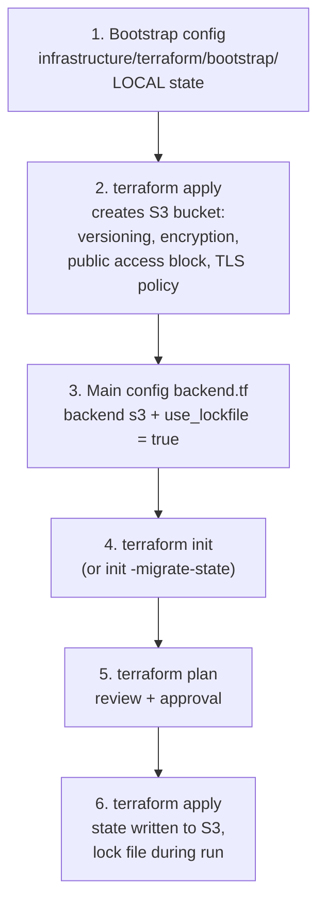

# Terraform State Management

| Field | Value |
|---|---|
| **Project** | Enterprise Systems Administration Lab (ESAL) |
| **Document** | Terraform State Management |
| **Version** | 1.0.0 |
| **Status** | DRAFT / PROPOSED |
| **Last updated** | 2026-11-22 |
| **Scope** | State fundamentals, S3 backend, encryption, versioning, locking, bootstrap, recovery, `.gitignore` |

> **Status:** No state bucket exists and Terraform has **not** been run. Configuration snippets
> are **illustrative — VALIDATION REQUIRED**.

---

## 1. Terraform State Fundamentals

Terraform records what it manages in a **state file** (`terraform.tfstate`, JSON). The state maps
configuration (`aws_instance.dc`) to real objects (`i-0abc…`), stores attribute values, and lets
Terraform compute the difference between desired and actual infrastructure during `plan`.

| Without correct state | Consequence |
|---|---|
| State lost | Terraform tries to recreate resources that already exist |
| State edited concurrently | Corruption, duplicated resources |
| State leaked | Exposure of IDs, IPs and any sensitive attribute values |

## 2. Local State vs Remote State

| Aspect | Local (`terraform.tfstate` on disk) | Remote (S3 backend) |
|---|---|---|
| Location | Workstation folder | S3 bucket |
| Works from Windows **and** macOS | No (state lives on one machine) | **Yes** |
| Locking | Local only | Native S3 lock file |
| History / recovery | None unless manually copied | S3 versioning |
| Risk of committing to Git | High | Low |
| Project use | Bootstrap configuration only | **Main configuration** |

## 3. S3 Backend

**Illustrative backend configuration — VALIDATION REQUIRED**

```hcl
terraform {
  required_version = ">= 1.11.0"

  required_providers {
    aws = {
      source  = "hashicorp/aws"
      version = "~> 6.0" # pin to the major version validated for the project
    }
  }

  backend "s3" {
    bucket       = "nexora-tfstate-<account-id>-us-east-1"
    key          = "esal/lab/terraform.tfstate"
    region       = "us-east-1"
    encrypt      = true
    use_lockfile = true # native S3 state locking — no DynamoDB table
  }
}
```

> Backend blocks cannot use variables. Values can be supplied with `-backend-config` at
> `terraform init` to keep account-specific names out of the code if preferred.

### Terraform version requirement

The project recommends **Terraform 1.11 or later, subject to compatibility validation**. S3 native
locking was introduced as an experimental feature in 1.10 and became generally available in
1.11, which also deprecated the DynamoDB-related backend arguments.

## 4. State Sensitivity

State may contain: resource IDs, private and public IPs, ARNs, user data, and — depending on
resources — **secrets in plain text** (e.g. generated passwords). Therefore:

- State is **never** committed to Git.
- State is **never** attached to evidence or ZIP packages.
- Access to the bucket is restricted to the lab administrator.
- Sensitive outputs are marked `sensitive = true` (this hides them in CLI output, **not** in state).

## 5. Encryption

| Layer | Setting |
|---|---|
| Server-side | Bucket default encryption SSE-S3 (AES-256) or SSE-KMS |
| Backend flag | `encrypt = true` |
| In transit | HTTPS; bucket policy denies `aws:SecureTransport = false` |

SSE-KMS adds key-level access control and CloudTrail visibility of key use, at additional cost;
SSE-S3 is sufficient for the lab (decision: **PROPOSED SSE-S3**).

## 6. Bucket Versioning

Versioning keeps every previous object version. If a state write goes wrong, an earlier version
can be restored. Noncurrent versions can be expired after a period (lifecycle rule, e.g. 90 days)
to control storage cost — PROPOSED.

## 7. Public Access Block

All four settings enabled on the bucket:

| Setting | Value |
|---|---|
| `BlockPublicAcls` | true |
| `IgnorePublicAcls` | true |
| `BlockPublicPolicy` | true |
| `RestrictPublicBuckets` | true |

## 8. IAM Restrictions

| Principal | Required access |
|---|---|
| Terraform operator | `s3:ListBucket` on the bucket; `s3:GetObject`, `s3:PutObject` on the state key; `s3:GetObject`, `s3:PutObject`, `s3:DeleteObject` on the `.tflock` key |
| Everyone else | No access |

**Illustrative least-privilege policy — VALIDATION REQUIRED**

```json
{
  "Version": "2012-10-17",
  "Statement": [
    {
      "Sid": "ListStateBucket",
      "Effect": "Allow",
      "Action": "s3:ListBucket",
      "Resource": "arn:aws:s3:::nexora-tfstate-111122223333-us-east-1"
    },
    {
      "Sid": "ReadWriteState",
      "Effect": "Allow",
      "Action": ["s3:GetObject", "s3:PutObject"],
      "Resource": "arn:aws:s3:::nexora-tfstate-111122223333-us-east-1/esal/lab/terraform.tfstate"
    },
    {
      "Sid": "ManageLockFile",
      "Effect": "Allow",
      "Action": ["s3:GetObject", "s3:PutObject", "s3:DeleteObject"],
      "Resource": "arn:aws:s3:::nexora-tfstate-111122223333-us-east-1/esal/lab/terraform.tfstate.tflock"
    }
  ]
}
```

## 9. Native S3 State Locking — `use_lockfile = true`

| Item | Detail |
|---|---|
| How it works | Terraform writes `<key>.tflock` next to the state object using S3 conditional writes; a second process cannot acquire the lock while it exists |
| Requires | Terraform with S3 native locking support (project baseline ≥ 1.11) |
| DynamoDB | **Not required and not used** in this project |
| Stuck lock | `terraform force-unlock <LOCK_ID>` — only when certain no other run is active |

## 10. Bootstrap Process

The bucket must exist **before** the S3 backend can be configured ("chicken-and-egg" problem).

Diagram source: [`infrastructure/diagrams/terraform-deployment-flow.mmd`](../../infrastructure/diagrams/terraform-deployment-flow.mmd)



| Step | Notes |
|---|---|
| Bootstrap state | Kept locally, outside Git; optionally migrated to the bucket afterwards |
| Bucket protection | `lifecycle { prevent_destroy = true }` on the bucket resource |
| Order | Budget alert and region confirmation before bootstrap |

## 11. State Recovery Considerations

| Scenario | Recovery |
|---|---|
| Bad state write | Restore previous object version in S3, then `terraform plan` to verify |
| Resource exists but missing from state | `terraform import` (or `import` blocks) |
| Resource removed outside Terraform | `terraform plan` shows recreation; decide to apply or `terraform state rm` |
| Lock left behind after crash | `terraform force-unlock` after confirming no active run |
| Bucket deleted | Prevented by `prevent_destroy`; otherwise rebuild state with imports |

Never edit state JSON by hand; use `terraform state` subcommands.

## 12. `.gitignore` Rules

Required patterns (the repository's `.gitignore` is **currently empty** — gap to fix before any
Terraform work):

```gitignore
# Terraform
*.tfstate
*.tfstate.*
.terraform/
*.tfplan
*.tfvars
*.tfvars.json
!*.tfvars.example
crash.log
crash.*.log
override.tf
override.tf.json
*_override.tf
*_override.tf.json
# Commit .terraform.lock.hcl (provider checksums) — do NOT ignore it
```

## 13. Security Recommendations

1. Dedicated bucket for state only; name includes account ID and region for uniqueness.
2. Versioning, encryption, public access block, TLS-only policy.
3. Least-privilege IAM for the operator; no other principal has access.
4. `prevent_destroy` on the bucket.
5. Never print or share state; mark sensitive outputs.
6. Pin provider versions and commit `.terraform.lock.hcl`.
7. Review every `plan` before `apply`; no `destroy` without written authorisation.

## 14. Validation (post-bootstrap)

```bash
aws s3api get-bucket-versioning --bucket <state-bucket>
aws s3api get-bucket-encryption --bucket <state-bucket>
aws s3api get-public-access-block --bucket <state-bucket>
terraform init        # expect: Successfully configured the backend "s3"
terraform state list
```

| Check | Expected | Status |
|---|---|---|
| Versioning | `Status: Enabled` | NOT TESTED |
| Encryption | SSE configured | NOT TESTED |
| Public access block | All four `true` | NOT TESTED |
| Lock file appears during apply | `<key>.tflock` present while running | NOT TESTED |

## References

- HashiCorp — Backend type: s3: <https://developer.hashicorp.com/terraform/language/backend/s3>
- HashiCorp — State: <https://developer.hashicorp.com/terraform/language/state>
- HashiCorp — Sensitive data in state: <https://developer.hashicorp.com/terraform/language/state/sensitive-data>
- HashiCorp — Upgrading to Terraform v1.11 (S3 native locking): <https://developer.hashicorp.com/terraform/language/v1.11.x/upgrade-guides>
- HashiCorp — AWS provider: <https://registry.terraform.io/providers/hashicorp/aws/latest/docs>
- AWS — S3 Versioning: <https://docs.aws.amazon.com/AmazonS3/latest/userguide/Versioning.html>
- AWS — Blocking public access to S3 storage: <https://docs.aws.amazon.com/AmazonS3/latest/userguide/access-control-block-public-access.html>
- AWS — S3 default encryption: <https://docs.aws.amazon.com/AmazonS3/latest/userguide/bucket-encryption.html>
