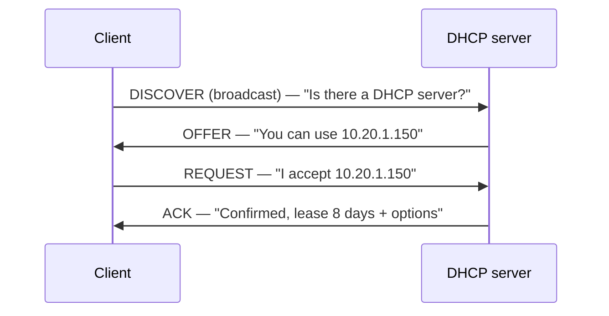
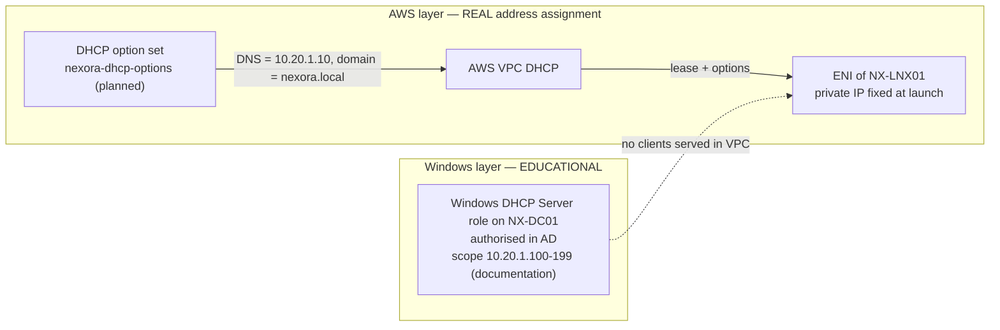

# DHCP Design — AWS VPC DHCP vs Windows DHCP

| Field | Value |
|---|---|
| **Project** | Enterprise Systems Administration Lab (ESAL) |
| **Document** | DHCP Design |
| **Version** | 1.0.0 |
| **Status** | DRAFT / PROPOSED |
| **Last updated** | 2026-11-22 |
| **Scope** | DHCP fundamentals, Windows DHCP role, AWS VPC DHCP, DHCP option sets, project architecture |

> **Key statement:** **The Windows DHCP Server role on NX-DC01 does NOT replace AWS VPC DHCP and
> does NOT assign addresses to EC2 network interfaces.** It is installed and configured for
> educational purposes only. Actual DHCP behaviour for EC2 is controlled by AWS, and is customised
> through **VPC DHCP option sets**.

---

## 1. DHCP Fundamentals

The Dynamic Host Configuration Protocol (RFC 2131) automatically gives a host:

- an IP address and subnet mask,
- a default gateway,
- DNS servers and a DNS domain name,
- other options (NTP, etc.),

for a limited time called a **lease**.

## 2. The DORA Process



| Step | Message | Sender |
|---|---|---|
| D | DHCPDISCOVER | Client (broadcast) |
| O | DHCPOFFER | Server |
| R | DHCPREQUEST | Client |
| A | DHCPACK | Server |

## 3. Scopes, Reservations, Leases and Options

| Concept | Definition | Example |
|---|---|---|
| Scope | Range of addresses a server may lease on a subnet | 10.20.1.100 – 10.20.1.199 |
| Exclusion | Addresses inside a scope that are never leased | 10.20.1.100 – 10.20.1.109 |
| Reservation | Fixed address for a specific MAC address | 10.20.1.150 → 0A-1B-… |
| Lease | Time a client may use an address before renewal | 8 days (Windows default) |
| Option 003 | Router (default gateway) | 10.20.1.1 |
| Option 006 | DNS servers | 10.20.1.10 |
| Option 015 | DNS domain name | nexora.local |

## 4. Windows DHCP Server Role

On a traditional LAN, a Windows DHCP server answers client broadcasts, leases addresses from its
scopes, and — in an AD domain — must be **authorised** in Active Directory before it serves
clients (prevents rogue DHCP servers).

## 5. AWS VPC DHCP Behaviour

In an Amazon VPC, DHCP is provided by the **AWS network infrastructure**, not by a server inside
the subnet:

| Behaviour | Explanation |
|---|---|
| Address source | The private IP is assigned to the **elastic network interface (ENI)** by AWS when the instance launches (automatically, or chosen with `private_ip`) |
| DHCP responses | AWS answers the guest OS's DHCP requests with the address already bound to the ENI |
| Broadcast | A VPC does not support broadcast, so a DHCP server running on an instance cannot receive other instances' DISCOVER broadcasts |
| Gateway | Always the subnet's base + 1 (e.g. 10.20.1.1) |
| Customisable options | DNS servers, domain name, NTP servers, NetBIOS name servers/node type — via a **DHCP option set** |

## 6. VPC DHCP Option Sets

A DHCP option set is a VPC-level object that defines the options AWS hands out to every instance
in the VPC.

| Option | Default value | Proposed custom value (`nexora-dhcp-options`) | Status |
|---|---|---|---|
| `domain-name` | AWS regional default (e.g. `ec2.internal` in us-east-1) | `nexora.local` | PLANNED (Day 04) |
| `domain-name-servers` | `AmazonProvidedDNS` | `10.20.1.10` + fallback (**VALIDATION REQUIRED** — see [dns.md §10](dns.md#10-relationship-with-the-dhcp-option-set)) | PLANNED (Day 04) |
| `ntp-servers` | Not set (Amazon Time Sync is available at 169.254.169.123) | Not changed | — |

Key facts:

- A VPC has exactly **one** option set associated at a time.
- Option sets are **immutable**: to change a value, create a new set and associate it.
- Running instances pick up new options when their **DHCP lease renews** (or on reboot / manual
  renewal).

## 7. AWS DHCP vs Windows DHCP — Comparison

| Aspect | AWS VPC DHCP | Windows DHCP Server role (NX-DC01) |
|---|---|---|
| Assigns IPs to EC2 ENIs | **Yes** | **No** |
| Where it runs | AWS infrastructure | Inside the Windows guest OS |
| Configured with | EC2/VPC API, Terraform, DHCP option sets | DHCP console, PowerShell `DhcpServer` module |
| Receives client broadcasts in the VPC | Handled by AWS | **No** (no broadcast in VPC) |
| Can set DNS server / domain name | Yes (option set) | Only for clients it serves (none in this VPC) |
| Role in this project | **Production behaviour** | **Educational exercise** |

## 8. Correct Project Architecture



| Task | Performed where | Validates |
|---|---|---|
| Fix instance IPs | Terraform `private_ip` | AWS ENI |
| Distribute DNS settings | DHCP option set | AWS DHCP |
| Install DHCP role | NX-DC01 | Windows administration skill |
| Authorise in AD | NX-DC01 | AD/DHCP integration |
| Create scope, exclusions, reservations, options | NX-DC01 | DHCP configuration skill |
| Back up / restore DHCP configuration | NX-DC01 | Operational procedure |
| Lease a client address | — | **Not possible in this VPC — documented limitation** |

## 9. Proposed Educational Windows DHCP Configuration

| Item | Value | Status |
|---|---|---|
| Scope name | `NEXORA-LAB-EDU` | PROPOSED |
| Range | 10.20.1.100 – 10.20.1.199 | PROPOSED |
| Mask | 255.255.255.0 | PROPOSED |
| Exclusions | 10.20.1.100 – 10.20.1.109 | PROPOSED |
| Lease duration | 8 days | PROPOSED |
| Options | 003 = 10.20.1.1 · 006 = 10.20.1.10 · 015 = nexora.local | PROPOSED |
| Scope state | **Inactive** (prevents any accidental interaction) | PROPOSED |

Illustrative commands (Day 02/04 — **not executed**):

```powershell
Install-WindowsFeature DHCP -IncludeManagementTools
Add-DhcpServerInDC -DnsName "nx-dc01.nexora.local" -IPAddress 10.20.1.10
Add-DhcpServerv4Scope -Name "NEXORA-LAB-EDU" -StartRange 10.20.1.100 -EndRange 10.20.1.199 `
    -SubnetMask 255.255.255.0 -State InActive -LeaseDuration 8.00:00:00
Add-DhcpServerv4ExclusionRange -ScopeId 10.20.1.0 -StartRange 10.20.1.100 -EndRange 10.20.1.109
Set-DhcpServerv4OptionValue -ScopeId 10.20.1.0 -Router 10.20.1.1 `
    -DnsServer 10.20.1.10 -DnsDomain "nexora.local"
```

## 10. DHCP Testing and Troubleshooting

**Validation of the Windows role (configuration only):**

```powershell
Get-DhcpServerInDC
Get-DhcpServerv4Scope
Get-DhcpServerv4OptionValue -ScopeId 10.20.1.0
Get-DhcpServerv4ExclusionRange -ScopeId 10.20.1.0
Export-DhcpServer -File C:\Temp\dhcp-backup.xml -Leases
```

**Validation of AWS DHCP (real behaviour):**

```bash
aws ec2 describe-vpcs --filters Name=tag:Name,Values=nexora-vpc --query "Vpcs[].DhcpOptionsId"
aws ec2 describe-dhcp-options --dhcp-options-ids <dopt-id>
```

```powershell
# On an instance: confirm DNS servers and suffix received from AWS DHCP
ipconfig /all
ipconfig /renew
```

```bash
resolvectl status
sudo networkctl renew <interface>   # or reboot after associating a new option set
```

| Symptom | Cause | Resolution |
|---|---|---|
| Instance still uses old DNS after new option set | Lease not renewed | Renew lease or reboot |
| Instance lost network after manual IP change in OS | Static IP set inside guest | Revert adapter to DHCP (via Session Manager / EC2 Serial Console) |
| Windows DHCP "not authorized" | Server not authorised in AD | `Add-DhcpServerInDC` |
| No leases on Windows DHCP | Expected: no broadcast in VPC | Documented limitation — no action |

| Test | Expected | Status |
|---|---|---|
| DHCP role installed and authorised | `Get-DhcpServerInDC` lists NX-DC01 | NOT TESTED |
| Scope present and inactive | `State = Inactive` | NOT TESTED |
| Instances receive `nexora.local` suffix (after option set) | `ipconfig /all` shows suffix | NOT TESTED |

## References

- AWS — DHCP option sets in Amazon VPC: <https://docs.aws.amazon.com/vpc/latest/userguide/VPC_DHCP_Options.html>
- AWS — Amazon EC2 instance IP addressing: <https://docs.aws.amazon.com/AWSEC2/latest/UserGuide/using-instance-addressing.html>
- AWS — Amazon Time Sync Service: <https://docs.aws.amazon.com/AWSEC2/latest/UserGuide/set-time.html>
- Microsoft — DHCP in Windows Server: <https://learn.microsoft.com/en-us/windows-server/networking/technologies/dhcp/dhcp-top>
- Microsoft — DhcpServer PowerShell module: <https://learn.microsoft.com/en-us/powershell/module/dhcpserver/>
- IETF — RFC 2131, Dynamic Host Configuration Protocol: <https://www.rfc-editor.org/rfc/rfc2131>
- IETF — RFC 2132, DHCP Options: <https://www.rfc-editor.org/rfc/rfc2132>
