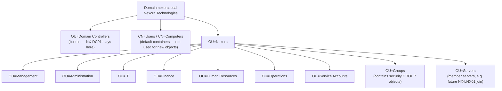

# Active Directory Domain Structure

| Field | Value |
|---|---|
| **Project** | Enterprise Systems Administration Lab (ESAL) |
| **Document** | Active Directory Domain Structure |
| **Version** | 1.0.0 |
| **Status** | DRAFT / PROPOSED |
| **Last updated** | 2026-11-22 |
| **Scope** | AD DS concepts, forest/domain design, OU hierarchy, DC architecture, deployment considerations |

> **Status:** Active Directory is **PROPOSED / NOT DEPLOYED**. NX-DC01 has not been launched or
> promoted.
>
> **Location note:** this document lives in `docs/networking/` to follow the repository's
> current folder structure, as decided by the project owner.

---

## 1. Active Directory Fundamentals

Active Directory Domain Services (AD DS) is Microsoft's directory service. It stores objects
(users, groups, computers, policies) and provides:

| Capability | Mechanism |
|---|---|
| Authentication | Kerberos (primary), NTLM (legacy) |
| Authorisation data | Security groups and SIDs in access tokens |
| Directory queries | LDAP |
| Central configuration | Group Policy |
| Service location | DNS SRV records |

## 2. Logical Components

| Component | Definition | In this project |
|---|---|---|
| **Forest** | Top-level security boundary; one schema and configuration | One forest, root domain `nexora.local` |
| **Domain** | Administrative and replication boundary inside a forest | One domain: `nexora.local` |
| **Organizational Unit (OU)** | Container for delegating administration and linking GPOs | Hierarchy in §6 |
| **Domain Controller (DC)** | Server holding a writable copy of the domain database | NX-DC01 |
| **Site** | Physical/network topology for replication | `Default-First-Site-Name` (renaming optional) |

## 3. Domain Controller

A DC runs AD DS, holds `NTDS.dit`, the SYSVOL share (Group Policy files and logon scripts) and, in
this design, the DNS Server role. The first DC in a forest also holds all five **FSMO roles**:

| FSMO role | Scope |
|---|---|
| Schema Master | Forest |
| Domain Naming Master | Forest |
| PDC Emulator | Domain (time source, password changes, GPO editing) |
| RID Master | Domain |
| Infrastructure Master | Domain |

## 4. DNS Dependency

AD **requires** DNS:

- Clients find DCs through SRV records (`_ldap._tcp.dc._msdcs.nexora.local`).
- The DC registers its records dynamically in the AD-integrated zone.
- If DNS is wrong, domain logons, GPO processing and replication fail.

See [dns.md](dns.md).

## 5. Domain Name — `nexora.local`

| Item | Value | Status |
|---|---|---|
| DNS name | `nexora.local` | Approved project decision |
| NetBIOS name | `NEXORA` | PROPOSED |
| Distinguished name | `DC=nexora,DC=local` | Derived |
| Forest / domain functional level | Windows Server 2016 (highest level offered by Windows Server 2022) | PROPOSED |

**Trade-off recorded:**

| Consideration | Detail |
|---|---|
| Microsoft guidance | Prefer a subdomain of a registered public domain (e.g. `ad.example.com`) for new forests |
| mDNS conflict | `.local` is reserved for Multicast DNS (RFC 6762); macOS resolves `.local` via Bonjour first |
| Public certificates | Public CAs do not issue certificates for `.local` names |
| Why accepted | The domain is used only inside the VPC; workstations never join or resolve it directly; the name is an approved academic decision |

> Renaming a domain after promotion is complex. Any change must be decided **before** Day 02.

## 6. Proposed OU Hierarchy

Diagram source: [`infrastructure/diagrams/active-directory-ou-structure.mmd`](../../infrastructure/diagrams/active-directory-ou-structure.mmd)



### 6.1 OU table

| OU | Distinguished name | Contains | Purpose |
|---|---|---|---|
| Nexora | `OU=Nexora,DC=nexora,DC=local` | Sub-OUs | Company root; anchor for company-wide GPOs |
| Management | `OU=Management,OU=Nexora,DC=nexora,DC=local` | User accounts | Executive team |
| Administration | `OU=Administration,OU=Nexora,DC=nexora,DC=local` | User accounts | Office administration |
| IT | `OU=IT,OU=Nexora,DC=nexora,DC=local` | User + admin accounts | IT staff |
| Finance | `OU=Finance,OU=Nexora,DC=nexora,DC=local` | User accounts | Finance staff |
| Human Resources | `OU=Human Resources,OU=Nexora,DC=nexora,DC=local` | User accounts | HR staff |
| Operations | `OU=Operations,OU=Nexora,DC=nexora,DC=local` | User accounts | Operations staff |
| Service Accounts | `OU=Service Accounts,OU=Nexora,DC=nexora,DC=local` | Service accounts / gMSAs | Non-human identities, restricted GPOs |
| Groups | `OU=Groups,OU=Nexora,DC=nexora,DC=local` | **Security group objects** | Central location for groups |
| Servers | `OU=Servers,OU=Nexora,DC=nexora,DC=local` | Member server computer objects | Server GPOs |

### 6.2 OUs are not security groups

| | Organizational Unit | Security group |
|---|---|---|
| What it is | A **container** in the directory tree | A **principal** with a SID |
| Used for | Organising objects, delegating admin, **linking GPOs** | **Granting permissions** (ACLs, rights) |
| Can be in an ACL | No | Yes |
| Membership | An object is in exactly one OU | An object can be in many groups |
| Example | `OU=Finance` holds Finance users | `GG-Finance-Users` grants access to a Finance share |

Placing a user in `OU=Finance` gives **no** permissions by itself; adding them to
`GG-Finance-Users` does. See [users-groups.md](users-groups.md).

## 7. Administrative Roles

| Role | Holder | Scope | Notes |
|---|---|---|---|
| Built-in Administrator | Renamed/secured, break-glass only | Domain | Password stored securely offline; not for daily use |
| Domain Admins | `adm-` accounts of IT (minimal number) | Domain | Membership reviewed; used only for domain-level tasks |
| Delegated OU administrators | `GG-IT-HelpDesk` | Department OUs | Reset passwords, unlock accounts (delegation, not Domain Admins) |
| Server administrators | `GG-IT-ServerAdmins` | `OU=Servers` | Local admin on member servers via GPO |
| `ssm-user` (domain account) | Systems Manager | Domain | Required for Session Manager on a DC — see [systems-manager.md](../cloud/systems-manager.md#8-domain-controller-consideration-ssm-user) |

## 8. Domain Controller Architecture

| Attribute | NX-DC01 |
|---|---|
| Platform | EC2, Windows Server 2022 Full (Desktop Experience) |
| Roles | AD DS, DNS Server, (DHCP Server — educational) |
| Proposed IP | 10.20.1.10 (fixed at ENI) — PENDING IMPLEMENTATION |
| DNS client setting | 127.0.0.1 / own IP after promotion |
| Time source | PDC Emulator syncs with Amazon Time Sync (169.254.169.123) — VALIDATION REQUIRED |
| Database / logs / SYSVOL | Default paths on the root volume (lab simplification) |
| Backup | System State backup + EBS snapshot (Day 07) |
| Redundancy | **None** (single DC — documented limitation) |

## 9. Deployment Considerations

1. Instance launched with a static private IP **before** promotion.
2. Hostname set to `NX-DC01` and rebooted **before** promotion.
3. Session Manager behaviour changes after promotion (`ssm-user`) — plan access first.
4. Directory Services Restore Mode (DSRM) password supplied interactively or from a secure store —
   **never** hard-coded in scripts.
5. DNS forwarder configured to 10.20.0.2 after promotion.
6. Reverse lookup zone created.
7. OUs created before users and groups; new objects never left in `CN=Users`.
8. Default redirect of new computers/users to OUs (`redircmp` / `redirusr`) — optional.
9. EBS snapshot taken immediately after a healthy promotion.

Illustrative promotion sequence (Day 02 — **not executed**):

```powershell
Rename-Computer -NewName "NX-DC01" -Restart
Install-WindowsFeature AD-Domain-Services -IncludeManagementTools
Install-ADDSForest -DomainName "nexora.local" -DomainNetbiosName "NEXORA" `
    -InstallDns -SafeModeAdministratorPassword (Read-Host -AsSecureString "DSRM password")
```

Validation (post-deployment):

```powershell
Get-ADDomain | Select-Object DNSRoot, NetBIOSName, DomainMode
Get-ADForest | Select-Object Name, ForestMode, SchemaMaster
Get-ADOrganizationalUnit -Filter * | Select-Object Name, DistinguishedName
netdom query fsmo
dcdiag /v
```

| Check | Expected | Status |
|---|---|---|
| Domain exists | `DNSRoot = nexora.local` | NOT TESTED |
| OUs created | 9 OUs under `OU=Nexora` | NOT TESTED |
| `dcdiag` | No failed tests | NOT TESTED |

## References

- Microsoft — Active Directory Domain Services overview: <https://learn.microsoft.com/en-us/windows-server/identity/ad-ds/get-started/virtual-dc/active-directory-domain-services-overview>
- Microsoft — Selecting the forest root domain: <https://learn.microsoft.com/en-us/windows-server/identity/ad-ds/plan/selecting-the-forest-root-domain>
- Microsoft — Install a new Active Directory forest using PowerShell: <https://learn.microsoft.com/en-us/windows-server/identity/ad-ds/deploy/install-active-directory-domain-services--level-100->
- Microsoft — FSMO roles: <https://learn.microsoft.com/en-us/troubleshoot/windows-server/active-directory/fsmo-roles>
- Microsoft — ActiveDirectory PowerShell module: <https://learn.microsoft.com/en-us/powershell/module/activedirectory/>
- AWS — Session Manager prerequisites (ssm-user on domain controllers): <https://docs.aws.amazon.com/systems-manager/latest/userguide/session-manager-prerequisites.html>
- IETF — RFC 6762, Multicast DNS: <https://www.rfc-editor.org/rfc/rfc6762>
