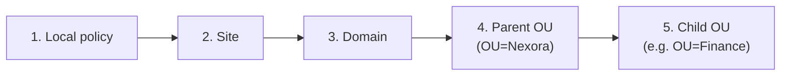

# Group Policy Objects (GPO)

| Field | Value |
|---|---|
| **Project** | Enterprise Systems Administration Lab (ESAL) |
| **Document** | Group Policy Objects |
| **Version** | 1.0.0 |
| **Status** | DRAFT / PROPOSED |
| **Last updated** | 2026-11-22 |
| **Scope** | GPO concepts, processing, inheritance, filtering, proposed policy matrix, validation, troubleshooting |

> **Status:** **No GPO has been created or linked.** Every policy below is **PROPOSED / NOT
> DEPLOYED / NOT TESTED**. Values are proposals to be reviewed against current Microsoft security
> baselines before implementation.

---

## 1. GPO Fundamentals

A Group Policy Object is a collection of settings stored in Active Directory (Group Policy
Container) and in SYSVOL (Group Policy Template). It is **linked** to a site, domain or OU and
applies to the users and computers in that scope.

| Part | Applies to | Refresh |
|---|---|---|
| Computer Configuration | Computer objects | At startup + every 90 min (± 30 min random offset) |
| User Configuration | User objects | At logon + same background interval |

Domain Controllers refresh policy every 5 minutes.

## 2. GPO Processing Order — LSDOU



Policies applied **later win** on conflicting settings, so the OU closest to the object has the
final say — unless enforcement or blocking changes the behaviour (§3).

## 3. Inheritance

| Mechanism | Effect | Project guidance |
|---|---|---|
| Default inheritance | Child OUs receive GPOs linked to parents | Use by default |
| **Block Inheritance** (on an OU) | Stops parent GPOs from applying | Avoid; makes behaviour hard to reason about |
| **Enforced** (on a link) | Parent GPO cannot be blocked and wins over child settings | Only for critical security baselines |
| Loopback processing | Applies user settings based on the computer's location | Not needed (no client workstations) |

## 4. Link Order

When several GPOs are linked to the same container, **link order 1 has the highest precedence**
(it is processed last). Keep few GPOs per OU and document their order.

## 5. Security Filtering and WMI Filtering

| Filter | How it works | Example |
|---|---|---|
| Security filtering | GPO applies only to principals with **Read** + **Apply group policy** | Apply a policy only to `GG-IT-Users` |
| WMI filtering | Query evaluated on the target computer | Apply only to Windows Server 2022 |
| Item-level targeting | Group Policy Preferences only | Map a drive only for Finance |

> Since MS16-072, computer accounts (e.g. `Authenticated Users` or `Domain Computers`) must keep
> **Read** permission on user-targeted GPOs even when security filtering is narrowed.

## 6. Password Policy

Domain-wide password and lockout policy is effective **only** when set in a GPO linked at the
**domain** (normally the *Default Domain Policy*). Exceptions use **Fine-Grained Password Policies
(FGPP)**, not OU-linked GPOs.

| Setting | Proposed value | Rationale | Status |
|---|---|---|---|
| Minimum password length | 14 characters | Aligns with common modern baselines | PROPOSED |
| Password complexity | Enabled | Defence against simple passwords | PROPOSED |
| Maximum password age | 0 (no expiry) or 365 days — **decision required** | Modern guidance discourages frequent forced rotation | VALIDATION REQUIRED |
| Minimum password age | 1 day | Prevents rapid cycling through history | PROPOSED |
| Enforce password history | 24 | Prevents reuse | PROPOSED |
| Store passwords using reversible encryption | Disabled | Never enable | PROPOSED |
| FGPP for `adm-` accounts | Minimum length 16 (proposed) | Stronger control for privileged identities | PROPOSED |

## 7. Account Lockout Policy

| Setting | Proposed value | Status |
|---|---|---|
| Account lockout threshold | 10 invalid attempts | PROPOSED |
| Lockout duration | 15 minutes | PROPOSED |
| Reset lockout counter after | 15 minutes | PROPOSED |

A low threshold makes accounts easy to lock out maliciously (denial of service); a high threshold
weakens brute-force protection. The proposed values balance both for a lab.

## 8. Windows Defender Firewall

| Setting | Proposed value | Status |
|---|---|---|
| Firewall state (Domain/Private/Public) | On | PROPOSED |
| Inbound default | Block | PROPOSED |
| Outbound default | Allow | PROPOSED |
| Logging of dropped packets | Enabled, `%systemroot%\system32\LogFiles\Firewall\pfirewall.log` | PROPOSED |
| Rule management | Keep default AD/DNS rules on the DC; no custom inbound rules beyond requirements | PROPOSED |

Host firewall and Security Groups are **complementary** layers (see
[security-groups.md](security-groups.md)).

## 9. Security Auditing

Use **Advanced Audit Policy Configuration** (not the legacy categories) and enable
"Force audit policy subcategory settings to override audit policy category settings".

| Subcategory | Setting | Purpose | Status |
|---|---|---|---|
| Credential Validation | Success, Failure | Authentication attempts | PROPOSED |
| Kerberos Authentication Service | Success, Failure | TGT requests | PROPOSED |
| User Account Management | Success, Failure | Account changes | PROPOSED |
| Security Group Management | Success, Failure | Group membership changes | PROPOSED |
| Logon / Logoff — Logon | Success, Failure | Interactive and network logons | PROPOSED |
| Account Lockout | Failure | Lockout events | PROPOSED |
| Directory Service Changes | Success | Changes to AD objects | PROPOSED |
| Audit Policy Change | Success | Tampering with audit settings | PROPOSED |
| Security event log maximum size | Increased (e.g. 512 MB — VALIDATION REQUIRED vs disk size) | Retain events | PROPOSED |

Selected events are candidates for forwarding to CloudWatch Logs (Day 06).

## 10. Administrative Restrictions

| Control | Mechanism | Target | Status |
|---|---|---|---|
| Deny interactive logon for service accounts | User Rights Assignment — *Deny log on locally* / *Deny log on through RDS* | `OU=Service Accounts` principals | PROPOSED |
| Restrict server local admins | Restricted Groups or Group Policy Preferences (Local Users and Groups) | `OU=Servers` → `GG-IT-ServerAdmins` | PROPOSED |
| Limit who can log on to the DC | *Allow log on locally* (DC policy) | Administrators only (default) | PROPOSED |
| Disable SMBv1 | Registry / feature removal | All servers | PROPOSED |
| Interactive logon banner | Security Options — message title/text | Domain | PROPOSED |
| Screen lock (user) | Screen saver timeout + password protect | Department OUs | PROPOSED |

## 11. Proposed Policy Matrix

| GPO name | Linked to | Enforced | Filtering | Main settings | Status |
|---|---|---|---|---|---|
| Default Domain Policy | `nexora.local` | No | Authenticated Users | Password + lockout (§6, §7) | PROPOSED (edit) |
| Default Domain Controllers Policy | `OU=Domain Controllers` | No | Default | User rights for DCs | PROPOSED (review only) |
| `NX-DC-Audit-Policy` | `OU=Domain Controllers` | No | Default | Advanced audit (§9), event log size | PROPOSED |
| `NX-Baseline-Security` | `OU=Nexora` | **Yes** | Authenticated Users | Logon banner, SMBv1 disabled, firewall on | PROPOSED |
| `NX-Servers-Admins` | `OU=Servers` | No | Default | Local Administrators = `GG-IT-ServerAdmins` | PROPOSED |
| `NX-ServiceAccounts-Restrictions` | `OU=Service Accounts` | No | Default | Deny interactive / RDP logon | PROPOSED |
| `NX-Users-Desktop` | Department OUs | No | Default | Screen lock, Control Panel restrictions (non-IT) | PROPOSED |
| FGPP `NX-PSO-Admins` | `adm-` accounts group (not a GPO) | — | — | Stronger password policy | PROPOSED |

> **Lab limitation:** there are no domain-joined client workstations. User-configuration GPOs will
> be validated with **Group Policy Modeling / RSoP reports** rather than real user logons.

## 12. PowerShell Validation Commands (post-deployment)

```powershell
Import-Module GroupPolicy

# Inventory and links
Get-GPO -All | Select-Object DisplayName, GpoStatus, ModificationTime
Get-GPInheritance -Target "OU=Finance,OU=Nexora,DC=nexora,DC=local"

# Reports
Get-GPOReport -Name "NX-Baseline-Security" -ReportType Html -Path C:\Temp\NX-Baseline-Security.html
Get-GPResultantSetOfPolicy -ReportType Html -Path C:\Temp\rsop-dc.html   # computer side, on the DC

# Password policy actually in force
Get-ADDefaultDomainPasswordPolicy
Get-ADFineGrainedPasswordPolicy -Filter *

# Audit policy actually in force
auditpol /get /category:*

# Force refresh and show applied GPOs
gpupdate /force
gpresult /r /scope computer
```

| Check | Expected | Status |
|---|---|---|
| GPOs exist and are linked as in §11 | All present | NOT TESTED |
| `Get-ADDefaultDomainPasswordPolicy` | MinPasswordLength = 14 | NOT TESTED |
| `auditpol` | Subcategories as §9 | NOT TESTED |
| `gpresult` on DC | Lists `NX-DC-Audit-Policy` | NOT TESTED |

## 13. Troubleshooting

| Symptom | Possible cause | Diagnostic |
|---|---|---|
| GPO not applied | Not linked / link disabled / wrong OU | `Get-GPInheritance`, GPMC |
| GPO applied to wrong objects | Security filtering incorrect | GPO *Delegation* tab, `gpresult /h` |
| User settings missing | Computer account lacks Read (MS16-072) | Check GPO delegation |
| Password policy not effective | Set on an OU instead of the domain | `Get-ADDefaultDomainPasswordPolicy` |
| "The processing of Group Policy failed" | DNS or SYSVOL problems | Event Viewer → *GroupPolicy* operational log; `dcdiag /test:sysvolcheck`; DNS checks |
| Settings conflict | Precedence / enforced link | RSoP report "Winning GPO" column |

## References

- Microsoft — Group Policy overview: <https://learn.microsoft.com/en-us/previous-versions/windows/it-pro/windows-server-2012-r2-and-2012/hh831791(v=ws.11)>
- Microsoft — GroupPolicy PowerShell module: <https://learn.microsoft.com/en-us/powershell/module/grouppolicy/>
- Microsoft — Password policy settings: <https://learn.microsoft.com/en-us/previous-versions/windows/it-pro/windows-10/security/threat-protection/security-policy-settings/password-policy>
- Microsoft — Fine-grained password policies: <https://learn.microsoft.com/en-us/windows-server/identity/ad-ds/get-started/adac/fine-grained-password-policies>
- Microsoft — Advanced security audit policy settings: <https://learn.microsoft.com/en-us/previous-versions/windows/it-pro/windows-10/security/threat-protection/auditing/advanced-security-audit-policy-settings>
- Microsoft — Windows security baselines: <https://learn.microsoft.com/en-us/windows/security/operating-system-security/device-management/windows-security-configuration-framework/windows-security-baselines>
- Microsoft — Cannot apply user GPO when computer objects lack Read (MS16-072): <https://learn.microsoft.com/en-us/troubleshoot/windows-server/group-policy/cannot-apply-user-gpo-when-computer-objects-dont-have-read-permissions>
