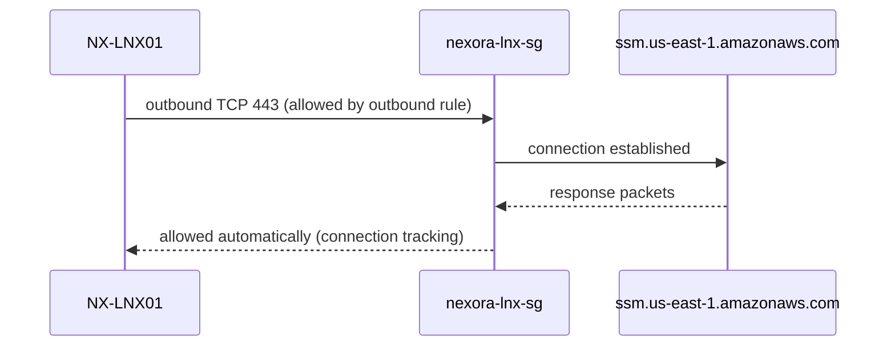

# Security Groups

| Field | Value |
|---|---|
| **Project** | Enterprise Systems Administration Lab (ESAL) |
| **Document** | Security Groups |
| **Version** | 1.0.0 |
| **Status** | DRAFT / PROPOSED |
| **Last updated** | 2026-11-22 |
| **Scope** | Security Group fundamentals, proposed rules for NX-DC01 and NX-LNX01, SSM connectivity |

> **Status:** Every rule in this document is **PROPOSED**. **Deployed rules: none** (see §7).
> **No rule opens TCP 22 or TCP 3389 to `0.0.0.0/0` — and none ever will in this project.**

---

## 1. Security Group Fundamentals

A Security Group (SG) is a virtual, **stateful** firewall attached to an elastic network interface.

| Property | Behaviour |
|---|---|
| Rule type | **Allow only** (no deny rules) |
| Default inbound | Deny all (nothing is allowed until a rule is added) |
| Default outbound | Allow all (on a new SG) |
| Evaluation | All rules are evaluated together; order does not matter |
| Sources/destinations | CIDR blocks, prefix lists, or **other Security Groups** |
| Scope | Applies per ENI; several SGs can be attached to one ENI |

## 2. Stateful Behaviour

If an instance opens an outbound connection, the **return traffic is allowed automatically**,
whatever the inbound rules say. This is why instances can reach Systems Manager and download
updates without **any** inbound rule.



## 3. Inbound Rules

Inbound rules define which sources may **initiate** connections to the instance. Project policy:

- No source `0.0.0.0/0` or `::/0` on any inbound rule.
- Inter-server rules reference the **source Security Group**, not IP ranges.
- Every rule has a `description` explaining why it exists.

## 4. Outbound Rules

| Option | Pros | Cons | Decision |
|---|---|---|---|
| Allow all outbound (default) | Simple; SSM, updates, CloudWatch work | Broader egress | **Initial design** |
| Restrict to TCP 443/80 + DNS to DC | Tighter egress | Must allow all required endpoints; easy to break SSM or updates | Optional Day 04 exercise |

## 5. Least Privilege Applied

| Principle | Application |
|---|---|
| Minimum ports | Only services that are actually used |
| Minimum sources | SG references instead of CIDRs |
| No administrative exposure | SSM replaces SSH/RDP |
| Local-only services | MariaDB listens on 127.0.0.1 — no SG rule |

## 6. Server Requirements

### 6.1 NX-DC01 — Domain Controller

Ports needed by domain members (here, NX-LNX01 in a future domain-join scenario) to use AD:

| Service | Protocol | Port(s) |
|---|---|---|
| DNS | TCP/UDP | 53 |
| Kerberos | TCP/UDP | 88 |
| NTP (W32Time) | UDP | 123 |
| RPC Endpoint Mapper | TCP | 135 |
| LDAP | TCP/UDP | 389 |
| SMB (SYSVOL/NETLOGON) | TCP | 445 |
| Kerberos password change | TCP/UDP | 464 |
| LDAPS | TCP | 636 |
| Global Catalog | TCP | 3268–3269 |
| RPC dynamic range | TCP | 49152–65535 |

### 6.2 NX-LNX01 — Linux server

| Service | Exposure |
|---|---|
| Nginx HTTP 80 | Reachable only from `nexora-dc-sg` (testing) or via SSM port forwarding |
| MariaDB 3306 | Localhost only |
| SSH 22 | **Not exposed**; Session Manager is used |

## 7. Rules Matrix

### 7.1 Proposed rules

**`nexora-dc-sg` (NX-DC01)**

| # | Dir. | Protocol | Port(s) | Source / Destination | Description | Phase | Status |
|---|---|---|---|---|---|---|---|
| DC-IN-01 | In | TCP+UDP | 53 | `nexora-lnx-sg` | DNS queries from Linux server | Day 04 | PROPOSED |
| DC-IN-02 | In | TCP+UDP | 88 | `nexora-lnx-sg` | Kerberos authentication | Future domain join | PROPOSED |
| DC-IN-03 | In | UDP | 123 | `nexora-lnx-sg` | Time synchronisation with DC | Future domain join | PROPOSED |
| DC-IN-04 | In | TCP | 135 | `nexora-lnx-sg` | RPC endpoint mapper | Future domain join | PROPOSED |
| DC-IN-05 | In | TCP+UDP | 389 | `nexora-lnx-sg` | LDAP | Future domain join | PROPOSED |
| DC-IN-06 | In | TCP | 445 | `nexora-lnx-sg` | SMB / SYSVOL | Future domain join | PROPOSED |
| DC-IN-07 | In | TCP+UDP | 464 | `nexora-lnx-sg` | Kerberos password change | Future domain join | PROPOSED |
| DC-IN-08 | In | TCP | 636 | `nexora-lnx-sg` | LDAPS | Future domain join | PROPOSED |
| DC-IN-09 | In | TCP | 3268–3269 | `nexora-lnx-sg` | Global Catalog | Future domain join | PROPOSED |
| DC-IN-10 | In | TCP | 49152–65535 | `nexora-lnx-sg` | RPC dynamic ports | Future domain join | PROPOSED |
| DC-OUT-01 | Out | All | All | 0.0.0.0/0 | SSM, CloudWatch, Windows Update, DNS forwarding | Day 05 | PROPOSED |

**`nexora-lnx-sg` (NX-LNX01)**

| # | Dir. | Protocol | Port(s) | Source / Destination | Description | Phase | Status |
|---|---|---|---|---|---|---|---|
| LNX-IN-01 | In | TCP | 80 | `nexora-dc-sg` | HTTP test from the DC | Day 04 | PROPOSED |
| LNX-OUT-01 | Out | All | All | 0.0.0.0/0 | SSM, CloudWatch, apt, queries to DC | Day 05 | PROPOSED |

> Implement rules incrementally: start with DC-IN-01 (DNS) and LNX-IN-01 (HTTP); add AD rules only
> when the domain-join exercise is approved.

### 7.2 Deployed rules

| Security Group | Rule | Deployed on | Evidence |
|---|---|---|---|
| — | **None deployed** | — | — |

*This table is updated only from real `aws ec2 describe-security-group-rules` output.*

### 7.3 Prohibited rules

| Port | Service | Source | Reason |
|---|---|---|---|
| 22 | SSH | 0.0.0.0/0, ::/0, any public IP | Replaced by Session Manager |
| 3389 | RDP | 0.0.0.0/0, ::/0, any public IP | Replaced by Fleet Manager / port forwarding |
| 3306 | MariaDB | Any | Local-only service |
| Any | Any | 0.0.0.0/0 inbound | Project policy |

## 8. Validation Procedures

```bash
# 1. Any inbound rule open to the world? Expected: no output.
aws ec2 describe-security-group-rules \
  --filters Name=tag:Project,Values=ESAL \
  --query "SecurityGroupRules[?IsEgress==\`false\` && (CidrIpv4=='0.0.0.0/0' || CidrIpv6=='::/0')]" \
  --output table

# 2. Full rule listing for review / evidence
aws ec2 describe-security-group-rules \
  --filters Name=group-id,Values=<sg-id> \
  --query "SecurityGroupRules[].[IsEgress,IpProtocol,FromPort,ToPort,CidrIpv4,ReferencedGroupInfo.GroupId,Description]" \
  --output table
```

> Tag filters apply to the rule's own tags. If rules are not tagged, filter by `group-id` instead.

```powershell
# From NX-DC01: HTTP test to the Linux server (after LNX-IN-01)
Test-NetConnection -ComputerName 10.20.1.20 -Port 80
```

```bash
# From NX-LNX01: DNS test to the DC (after DC-IN-01)
dig @10.20.1.10 nx-dc01.nexora.local +short
```

| Test | Expected | Status |
|---|---|---|
| No world-open inbound rules | Empty result | NOT TESTED |
| DNS from LNX to DC | Answer 10.20.1.10 | NOT TESTED |
| HTTP from DC to LNX | `TcpTestSucceeded : True` | NOT TESTED |

## 9. SSM Connectivity and Administrative Access

| Requirement | Satisfied by |
|---|---|
| Outbound HTTPS 443 to `ssm`, `ssmmessages`, `ec2messages` regional endpoints | Outbound rules DC-OUT-01 / LNX-OUT-01 + route to IGW + public IPv4 |
| Inbound rule for Session Manager | **Not required** |
| Inbound rule for Fleet Manager Remote Desktop | **Not required** |

Details: [systems-manager.md](../cloud/systems-manager.md).

## References

- AWS — Control traffic to resources using security groups: <https://docs.aws.amazon.com/vpc/latest/userguide/vpc-security-groups.html>
- AWS — Security group rules: <https://docs.aws.amazon.com/vpc/latest/userguide/security-group-rules.html>
- AWS — Session Manager prerequisites (endpoints): <https://docs.aws.amazon.com/systems-manager/latest/userguide/session-manager-prerequisites.html>
- Microsoft — Service overview and network port requirements for Windows: <https://learn.microsoft.com/en-us/troubleshoot/windows-server/networking/service-overview-and-network-port-requirements>
- Microsoft — How to configure a firewall for Active Directory domains and trusts: <https://learn.microsoft.com/en-us/troubleshoot/windows-server/active-directory/config-firewall-for-ad-domains-and-trusts>
