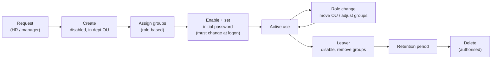
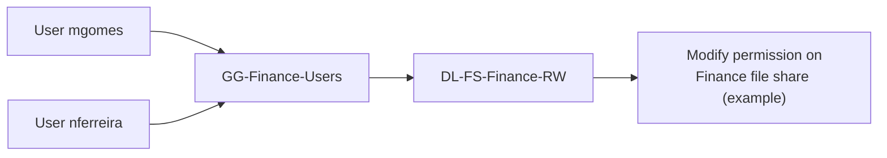

# Users and Groups

| Field | Value |
|---|---|
| **Project** | Enterprise Systems Administration Lab (ESAL) |
| **Document** | Users and Groups |
| **Version** | 1.0.0 |
| **Status** | DRAFT / PROPOSED |
| **Last updated** | 2026-11-22 |
| **Scope** | Account lifecycle, naming, security groups, nesting, RBAC, admin and service accounts, examples |

> **Status:** No account or group exists yet — **PROPOSED / NOT DEPLOYED**.
> **All names below are fictional.** No real person's data is used.

---

## 1. User Account Lifecycle



| Stage | Control |
|---|---|
| Joiner | Account created **disabled**; enabled only after group assignment |
| Mover | Group changes reviewed; old access removed |
| Leaver | Disable immediately; move to a disabled-users location (optional); delete after retention |

## 2. Naming Conventions

| Object | Convention | Example | Notes |
|---|---|---|---|
| Standard user (`sAMAccountName`) | first initial + surname, lowercase ASCII | `alopes` | Max 20 characters; add a digit on collision (`alopes2`) |
| UPN | `<sAMAccountName>@nexora.local` | `alopes@nexora.local` | |
| Display name | `Firstname Surname` | `Ana Lopes` | |
| Administrative account | `adm-<sAMAccountName>` | `adm-alopes` | Separate identity for privileged work |
| Service account | `svc-<service>` | `svc-backup` | Prefer gMSA where supported |
| Global security group | `GG-<Department or Role>-<Purpose>` | `GG-Finance-Users` | Holds users (role groups) |
| Domain local group | `DL-<Resource>-<Permission>` | `DL-FS-Finance-RW` | Assigned on resource ACLs |
| Computer | `NX-<ROLE><NN>` | `NX-DC01` | |

## 3. Security Groups

| Group scope | Can contain | Can be used for permissions in | Project use |
|---|---|---|---|
| Domain local (DL) | Users, global and universal groups from any trusted domain | Same domain | Resource permissions |
| Global (GG) | Users and global groups from the same domain | Any trusting domain | Role / department groups |
| Universal | Users and groups from any domain in the forest | Any domain in the forest | Not needed (single domain) |

Group **type** is always **Security** (distribution groups are for email only).

## 4. Group Nesting — AGDLP

The project follows Microsoft's **AGDLP** model:

**A**ccounts → **G**lobal groups → **D**omain **L**ocal groups → **P**ermissions



Benefits: users are managed in one place (role group); permissions are managed in one place
(resource group); auditing is easier.

## 5. Role-Based Access Control (RBAC)

| Role | Global group | Typical rights |
|---|---|---|
| Employee (all) | `GG-Nexora-AllStaff` | Company-wide read resources |
| Department member | `GG-<Dept>-Users` | Department resources |
| IT help desk | `GG-IT-HelpDesk` | Reset passwords / unlock in department OUs (delegated) |
| Server administrator | `GG-IT-ServerAdmins` | Local admin on member servers |
| Domain administrator | `Domain Admins` (built-in) | Domain-wide — minimal membership |

## 6. Administrative Accounts

| Rule | Reason |
|---|---|
| Each IT administrator has a standard **and** an `adm-` account | Daily tasks (email, browsing) never run with privilege |
| `adm-` accounts are members of privileged groups; standard accounts are not | Limits credential-theft impact |
| Built-in `Administrator` is break-glass only | Reduces use of a well-known account |
| Privileged membership reviewed every phase | Detects privilege creep |
| `adm-` accounts are candidates for **Protected Users** | Hardens credential handling — VALIDATION REQUIRED (compatibility) |

## 7. Service Accounts

| Rule | Detail |
|---|---|
| Location | `OU=Service Accounts` |
| Interactive logon | Denied via GPO |
| Password | Long random value, or group Managed Service Account (gMSA) where supported |
| Privileges | Only what the service needs; never Domain Admins |
| Ownership | Each service account has a documented owner and purpose |

## 8. Example Users (fictional, PROPOSED)

| Department | Display name | sAMAccountName | OU | Member of |
|---|---|---|---|---|
| Management | Helena Duarte | `hduarte` | Management | GG-Management-Users, GG-Nexora-AllStaff |
| Management | Rui Matos | `rmatos` | Management | GG-Management-Users, GG-Nexora-AllStaff |
| IT | Ana Lopes | `alopes` | IT | GG-IT-Users, GG-Nexora-AllStaff |
| IT | Bruno Reis | `breis` | IT | GG-IT-Users, GG-Nexora-AllStaff |
| IT | Carla Nunes | `cnunes` | IT | GG-IT-Users, GG-IT-HelpDesk, GG-Nexora-AllStaff |
| Human Resources | Diana Faria | `dfaria` | Human Resources | GG-HR-Users, GG-Nexora-AllStaff |
| Human Resources | Eduardo Pinto | `epinto` | Human Resources | GG-HR-Users, GG-Nexora-AllStaff |
| Operations | Filipe Sousa | `fsousa` | Operations | GG-Operations-Users, GG-Nexora-AllStaff |
| Operations | Gabriela Rocha | `grocha` | Operations | GG-Operations-Users, GG-Nexora-AllStaff |
| Operations | Hugo Teixeira | `hteixeira` | Operations | GG-Operations-Users, GG-Nexora-AllStaff |
| Operations | Ines Moreira | `imoreira` | Operations | GG-Operations-Users, GG-Nexora-AllStaff |
| Administration | Joana Carvalho | `jcarvalho` | Administration | GG-Administration-Users, GG-Nexora-AllStaff |
| Administration | Luis Martins | `lmartins` | Administration | GG-Administration-Users, GG-Nexora-AllStaff |
| Finance | Marta Gomes | `mgomes` | Finance | GG-Finance-Users, GG-Nexora-AllStaff |
| Finance | Nuno Ferreira | `nferreira` | Finance | GG-Finance-Users, GG-Nexora-AllStaff |

**Administrative accounts (PROPOSED):**

| Account | Owner | OU | Member of |
|---|---|---|---|
| `adm-alopes` | Ana Lopes | IT | Domain Admins |
| `adm-breis` | Bruno Reis | IT | GG-IT-ServerAdmins |

Totals: 15 standard users, 2 administrative accounts.

## 9. Example Groups (PROPOSED)

| Group | Scope | Location | Members | Purpose |
|---|---|---|---|---|
| GG-Nexora-AllStaff | Global | OU=Groups | All department groups (nested) | Company-wide access |
| GG-Management-Users | Global | OU=Groups | Management users | Department role |
| GG-Administration-Users | Global | OU=Groups | Administration users | Department role |
| GG-IT-Users | Global | OU=Groups | IT users | Department role |
| GG-Finance-Users | Global | OU=Groups | Finance users | Department role |
| GG-HR-Users | Global | OU=Groups | HR users | Department role |
| GG-Operations-Users | Global | OU=Groups | Operations users | Department role |
| GG-IT-HelpDesk | Global | OU=Groups | `cnunes` | Delegated password reset |
| GG-IT-ServerAdmins | Global | OU=Groups | `adm-breis` | Member-server admin |
| DL-FS-Finance-RW | Domain local | OU=Groups | GG-Finance-Users | Example resource permission |
| DL-FS-HR-RW | Domain local | OU=Groups | GG-HR-Users | Example resource permission |

> In the example table in §8, `GG-Nexora-AllStaff` is shown per user for clarity; the
> implementation should nest department groups inside it instead of adding users individually.

## 10. PowerShell Administration Examples

> **Illustrative only — NOT EXECUTED.** Implementation scripts with full comment-based help will be
> delivered in the Day 02 package. Passwords are always requested interactively.

```powershell
Import-Module ActiveDirectory
$base = "OU=Nexora,DC=nexora,DC=local"

# Create a global security group in OU=Groups
New-ADGroup -Name "GG-Finance-Users" -GroupScope Global -GroupCategory Security `
    -Path "OU=Groups,$base" -Description "Finance department role group"

# Create a disabled user in the Finance OU
New-ADUser -Name "Marta Gomes" -GivenName "Marta" -Surname "Gomes" `
    -SamAccountName "mgomes" -UserPrincipalName "mgomes@nexora.local" `
    -Path "OU=Finance,$base" -Enabled $false

# Add to group, set initial password, force change, enable
Add-ADGroupMember -Identity "GG-Finance-Users" -Members "mgomes"
Set-ADAccountPassword -Identity "mgomes" -Reset `
    -NewPassword (Read-Host -AsSecureString "Initial password")
Set-ADUser -Identity "mgomes" -ChangePasswordAtLogon $true
Enable-ADAccount -Identity "mgomes"
```

Validation (post-deployment):

```powershell
Get-ADUser -Filter * -SearchBase "OU=Nexora,DC=nexora,DC=local" |
    Select-Object SamAccountName, Enabled, DistinguishedName
Get-ADGroupMember -Identity "GG-Finance-Users" -Recursive | Select-Object SamAccountName
Get-ADGroupMember -Identity "Domain Admins" | Select-Object SamAccountName
```

| Check | Expected | Status |
|---|---|---|
| 15 standard users in department OUs | Count = 15 | NOT TESTED |
| Domain Admins membership | Only approved `adm-` account(s) + built-in Administrator | NOT TESTED |
| No new objects in `CN=Users` | None | NOT TESTED |

## References

- Microsoft — Active Directory security groups: <https://learn.microsoft.com/en-us/windows-server/identity/ad-ds/manage/understand-security-groups>
- Microsoft — Group scope: <https://learn.microsoft.com/en-us/windows-server/identity/ad-ds/manage/understand-security-groups#group-scope>
- Microsoft — Best practices for securing Active Directory: <https://learn.microsoft.com/en-us/windows-server/identity/ad-ds/plan/security-best-practices/best-practices-for-securing-active-directory>
- Microsoft — Protected Users security group: <https://learn.microsoft.com/en-us/windows-server/security/credentials-protection-and-management/protected-users-security-group>
- Microsoft — Group Managed Service Accounts overview: <https://learn.microsoft.com/en-us/windows-server/security/group-managed-service-accounts/group-managed-service-accounts-overview>
- Microsoft — ActiveDirectory PowerShell module: <https://learn.microsoft.com/en-us/powershell/module/activedirectory/>
