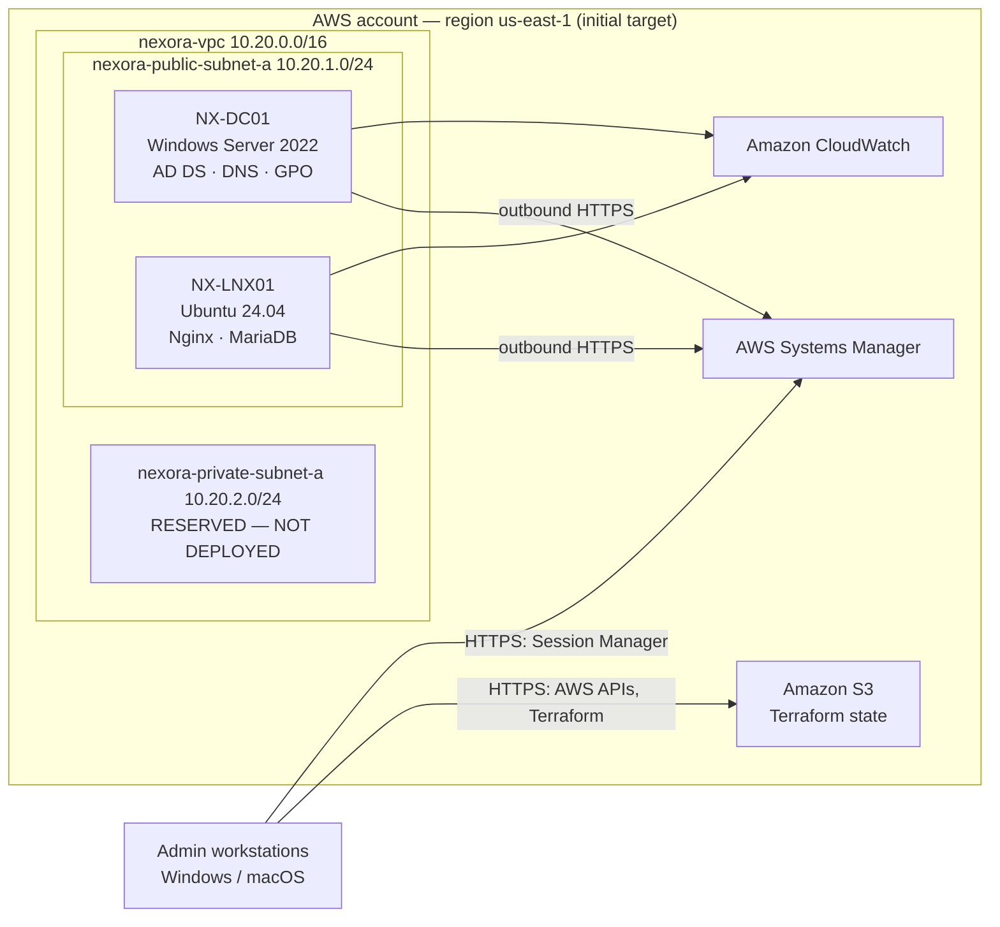

# Project Brief — Enterprise Systems Administration Lab

| Field | Value |
|---|---|
| **Project** | Enterprise Systems Administration Lab (ESAL) |
| **Document** | Project Brief |
| **Version** | 1.0.0 |
| **Status** | DRAFT / PROPOSED |
| **Last updated** | 2026-11-22 |
| **Scope** | Project context, objectives, scope, roadmap, deliverables, acceptance criteria, risks |

> **Implementation status:** No AWS resource has been provisioned. Every architecture element in
> this repository is **PROPOSED** or **PLANNED** and **NOT DEPLOYED** unless an evidence file in
> `evidence/` states otherwise.

---

## 1. Executive Summary

The Enterprise Systems Administration Lab is an academic infrastructure-engineering project that
designs, deploys, administers, secures, automates, tests and documents an enterprise-style
environment for the fictional company **Nexora Technologies**.

The environment runs **100 % on Amazon Web Services (AWS)**. Two Amazon EC2 instances form the
core of the lab:

- **NX-DC01** — Windows Server 2022 (Desktop Experience) providing Active Directory Domain
  Services, DNS and Group Policy for the domain `nexora.local`.
- **NX-LNX01** — Ubuntu Server 24.04 LTS providing Nginx, MariaDB and Linux administration
  services.

Infrastructure is defined with **Terraform**, administered through **AWS Systems Manager** (no
SSH or RDP exposed to the Internet), observed with **Amazon CloudWatch**, and version-controlled
in **Git/GitHub**. The project is portfolio-oriented and is explicitly **not** a production
environment.

## 2. Project Context

Small and medium organisations increasingly run their identity and line-of-business servers in the
public cloud instead of an on-premises server room. A systems administrator in that context must
combine traditional skills (Active Directory, DNS, Group Policy, Linux services, TCP/IP) with cloud
skills (VPC design, IAM, infrastructure as code, managed remote access, cost control).

This project builds that combined skill set in a controlled, low-cost laboratory.

**Important clarification:** EC2 instances are cloud-hosted virtual machines. The project
eliminates *locally hosted* virtual machines and hypervisors (VirtualBox, VMware, Hyper-V); it does
not eliminate virtualisation inside AWS.

## 3. Fictional Company — Nexora Technologies

Nexora Technologies is a fictional technology services company with a single logical office whose
IT services are hosted in AWS. Workstations used by the project author (Windows and macOS) act
only as **development and administration workstations**.

### 3.1 Organisational structure (PROPOSED)

| Department | Planned users | Notes |
|---|---|---|
| Management | 2 | Executive leadership |
| IT | 3 | Systems administration; holds separate admin accounts |
| Human Resources | 2 | Personnel data owners |
| Operations | 4 | Largest business unit |
| Administration | 2 | Office and general administration |
| Finance | 2 | Added in v1.0.0 of this documentation set |
| **Total** | **15** | Fictional identities only |

> Change note: earlier planning listed 13 users across five departments. The approved OU model now
> includes **Finance** alongside **Management**, giving six departments and 15 planned users.
> User counts remain **PROPOSED** until Active Directory is implemented.

## 4. Business Scenario

Nexora needs:

1. An individual identity for every employee.
2. Role-based security groups and permissions.
3. Centrally enforced security policies.
4. Defined server names and IP addressing.
5. Name resolution for internal services.
6. An internal web service and database.
7. Remote administration without exposing management ports.
8. Monitoring and logging.
9. Automation of repetitive administrative tasks.
10. Least-privilege access in AWS.
11. Documented recovery procedures.

## 5. Technical Objectives

| # | Objective | Primary technology |
|---|---|---|
| T1 | Provision a VPC-based network with defined CIDR ranges | Amazon VPC, Terraform |
| T2 | Deploy a Windows Server Domain Controller | EC2, Windows Server 2022, AD DS |
| T3 | Provide AD-integrated DNS for `nexora.local` | Windows DNS Server |
| T4 | Apply centralised security policy | Group Policy |
| T5 | Deploy and harden an Ubuntu server | EC2, Ubuntu 24.04, UFW, Fail2ban |
| T6 | Run web and database services | Nginx, MariaDB |
| T7 | Administer servers without inbound SSH/RDP | AWS Systems Manager |
| T8 | Apply IAM least privilege | AWS IAM, IAM Identity Center |
| T9 | Manage infrastructure as code with remote state | Terraform, Amazon S3 |
| T10 | Collect metrics and logs | Amazon CloudWatch |
| T11 | Automate administration | PowerShell, Bash, Python |

## 6. Learning Objectives

By the end of the project the author should be able to explain and demonstrate:

- Subnetting and CIDR planning in an AWS VPC.
- The difference between AWS VPC DHCP and the Windows DHCP Server role.
- Active Directory forest, domain, OU and group design.
- DNS zones, record types, forwarders and their AD dependency.
- Group Policy processing order, inheritance and filtering.
- Linux service administration and host firewalling.
- Stateful firewalling with Security Groups.
- IAM roles, instance profiles and temporary credentials.
- Terraform state, remote backends and state locking.
- Agent-based remote administration with Systems Manager.
- Cost awareness in a pay-as-you-go cloud.

## 7. Scope

**In scope**

- One AWS account, one region (initial target `us-east-1`), one VPC, one Availability Zone.
- One public subnet in use; one private subnet **reserved** (documented, not provisioned).
- Two EC2 instances (NX-DC01, NX-LNX01).
- IAM role and instance profile for Systems Manager.
- CloudWatch metrics and logs at minimal scale.
- S3 bucket for Terraform remote state.
- Active Directory, DNS, Group Policy, Windows DHCP role (educational only).
- Nginx, MariaDB, UFW, Fail2ban.
- Automation scripts, tests, evidence, runbooks and final report (later phases).

## 8. Out of Scope

- Local virtual machines, hypervisors, ISO-based installations.
- High availability (multiple DCs, multiple AZs, load balancers).
- Production workloads, real users or real personal data.
- Site-to-site VPN or real hybrid connectivity to an on-premises site.
- NAT Gateway and VPC Interface Endpoints in the initial architecture.
- Domain-joined client workstations.
- Commercial support, SLAs or compliance certification.

## 9. Technical Stack

| Category | Technology |
|---|---|
| Cloud provider | Amazon Web Services |
| Networking | Amazon VPC, Internet Gateway, route tables, Security Groups |
| Compute | Amazon EC2 |
| Windows | Windows Server 2022 Desktop Experience |
| Linux | Ubuntu Server 24.04 LTS |
| Directory | Active Directory Domain Services |
| Name resolution | Windows DNS Server, Amazon Route 53 Resolver (VPC resolver) |
| Address assignment | AWS VPC DHCP + DHCP option sets (Windows DHCP role: educational) |
| Web / database | Nginx / MariaDB |
| Host security | Windows Defender Firewall, UFW, Fail2ban |
| Identity (cloud) | AWS IAM, IAM Identity Center |
| Remote administration | AWS Systems Manager (Session Manager, Fleet Manager) |
| Monitoring | Amazon CloudWatch |
| Infrastructure as code | Terraform ≥ 1.11, HashiCorp AWS provider |
| Remote state | Amazon S3 with native state locking (`use_lockfile = true`) |
| Automation | PowerShell, Bash, Python, AWS CLI v2 |
| Version control | Git, GitHub |
| Documentation | Markdown, Mermaid |

## 10. Infrastructure Overview

Full detail: [infrastructure-diagram.md](architecture/infrastructure-diagram.md),
[aws-architecture.md](architecture/aws-architecture.md),
[network-topology.md](architecture/network-topology.md).

## 11. Seven-Day Implementation Roadmap

| Day | Phase | Main outcomes | Status |
|---|---|---|---|
| 01 | Foundation & Architecture | Repository, documentation foundation, workstation tooling, cost guardrails | PLANNED |
| 02 | Windows Server & Active Directory | NX-DC01 promoted, DNS, OUs, users, groups, GPOs | PLANNED |
| 03 | Linux Administration | NX-LNX01 hardened, Nginx, MariaDB, UFW, Fail2ban | PLANNED |
| 04 | Networking & Security | Inter-server Security Group rules, DHCP option set, firewall validation | PLANNED |
| 05 | AWS & Terraform | Complete Terraform codebase, S3 remote state, plan/apply/validation | PLANNED |
| 06 | Automation & Monitoring | Scripts, CloudWatch metrics, logs and alarms | PLANNED |
| 07 | Testing & Documentation | Test campaign, recovery tests, runbooks, final report | PLANNED |

> **Dependency note:** Days 02–03 require running EC2 instances. A minimal Terraform deployment
> (network, IAM, compute) may be brought forward as a preparatory implementation; Day 05 then
> completes and documents the full codebase.

## 12. Deliverables

| Deliverable | Location |
|---|---|
| Architecture and design documentation | `docs/` |
| Mermaid diagram sources | `infrastructure/diagrams/` |
| Terraform code | `infrastructure/terraform/` |
| Windows administration scripts | `windows-server/` |
| Linux administration scripts and configs | `linux-server/` |
| Automation | `automation/` |
| Test plans and cases | `tests/` |
| Execution evidence (sanitised) | `evidence/` |
| Documented ZIP package per phase | Delivered outside the repository |

## 13. Acceptance Criteria

The project is complete when:

- [ ] The AWS infrastructure is provisioned by Terraform and validated.
- [ ] Terraform state is stored remotely in S3 with versioning, encryption and native locking.
- [ ] No Security Group allows inbound TCP 22 or TCP 3389 from the Internet.
- [ ] Both instances are managed nodes in Systems Manager and reachable through Session Manager.
- [ ] `nexora.local` is operational; DNS forward and reverse lookups succeed.
- [ ] OUs, users and groups match [users-groups.md](networking/users-groups.md).
- [ ] GPOs from [gpo-policies.md](networking/gpo-policies.md) are applied and verified.
- [ ] NX-LNX01 runs Nginx and MariaDB with UFW and Fail2ban active.
- [ ] CloudWatch receives metrics and logs from both instances.
- [ ] Automation scripts are tested and documented.
- [ ] Recovery procedures are tested.
- [ ] Documentation reflects the deployed state; evidence contains no secrets.

## 14. Limitations

- Single Domain Controller: no AD redundancy.
- Single Availability Zone: no infrastructure high availability.
- Windows DHCP cannot assign addresses to EC2 network interfaces; see [dhcp.md](networking/dhcp.md).
- No client workstations: user-targeted GPOs are validated with modelling tools rather than
  real user logons.
- Public IPv4 addresses are used for outbound connectivity in place of a NAT Gateway.

## 15. Assumptions

- The author has an AWS account with permission to create VPC, EC2, IAM, SSM, CloudWatch and S3
  resources.
- `us-east-1` is the initial target region, subject to account availability, pricing and final
  deployment approval.
- Windows Server 2022 and Ubuntu 24.04 LTS AWS-provided images are available in the chosen region.
- The author works from Windows and macOS workstations with Internet access.

## 16. Risks

| ID | Risk | Impact | Mitigation |
|---|---|---|---|
| R1 | Unexpected AWS charges | Medium | AWS Budgets alerts, stop instances when idle, cleanup checklist |
| R2 | Credentials committed to Git | High | `.gitignore`, temporary SSO credentials, secret scanning |
| R3 | Terraform state loss or corruption | High | S3 versioning, native locking, no manual state edits |
| R4 | DC unavailable breaks domain DNS | Medium | Keep AWS resolver as fallback; documented start order |
| R5 | `.local` suffix conflicts with mDNS on macOS | Low | Documented in [domain-structure.md](networking/domain-structure.md) |
| R6 | Session Manager unavailable on the DC (`ssm-user`) | Medium | Documented manual handling in [systems-manager.md](cloud/systems-manager.md) |
| R7 | Free-tier or account plan restrictions | Medium | Verify instance-type eligibility before deployment |

## 17. Future Improvements

- Move instances to the private subnet with NAT Gateway or VPC endpoints.
- Second Domain Controller in another Availability Zone.
- Site-to-site VPN to simulate a real on-premises office.
- Join NX-LNX01 to the domain (SSSD/realmd).
- AWS Backup plans and cross-region snapshot copies.
- AWS Config and Security Hub for compliance checks.

## References

- AWS — What is Amazon VPC?: <https://docs.aws.amazon.com/vpc/latest/userguide/what-is-amazon-vpc.html>
- AWS — Amazon EC2 User Guide: <https://docs.aws.amazon.com/AWSEC2/latest/UserGuide/concepts.html>
- AWS — AWS Systems Manager User Guide: <https://docs.aws.amazon.com/systems-manager/latest/userguide/what-is-systems-manager.html>
- AWS — Well-Architected Framework: <https://docs.aws.amazon.com/wellarchitected/latest/framework/welcome.html>
- Microsoft — Active Directory Domain Services overview: <https://learn.microsoft.com/en-us/windows-server/identity/ad-ds/get-started/virtual-dc/active-directory-domain-services-overview>
- Ubuntu — Ubuntu Server documentation: <https://documentation.ubuntu.com/server/>
- HashiCorp — Terraform documentation: <https://developer.hashicorp.com/terraform/docs>
