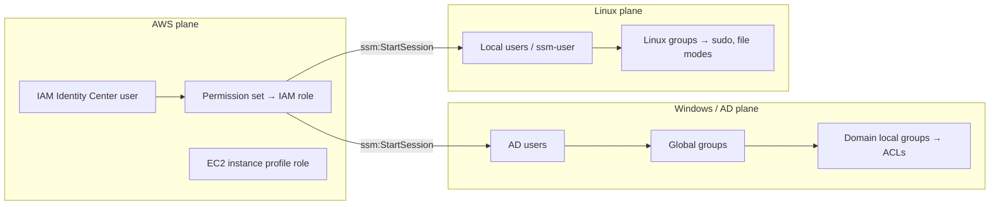

# Access Control

| Field | Value |
|---|---|
| **Project** | Enterprise Systems Administration Lab (ESAL) |
| **Document** | Access Control |
| **Version** | 1.0.0 |
| **Status** | DRAFT / PROPOSED |
| **Last updated** | 2026-11-22 |
| **Scope** | IAM concepts, authentication, authorisation, RBAC, admin separation, AD, Linux, SSM, AWS IAM, access review |

> **Status:** Access model is **PROPOSED / NOT DEPLOYED**.

---

## 1. Identity and Access Management Concepts

| Concept | Question it answers | Example |
|---|---|---|
| Identity | Who are you? | `alopes@nexora.local`, IAM Identity Center user |
| Authentication | Can you prove it? | Password + Kerberos; SSO + MFA |
| Authorisation | What may you do? | Group membership, IAM policy |
| Accounting / audit | What did you do? | Security event log, CloudTrail, SSM session history |

The project has **three identity planes**:



The **AWS plane controls who can reach the servers at all**; AD and Linux control what happens
inside them.

## 2. Authentication

| Plane | Method | Strength measures |
|---|---|---|
| AWS (human) | IAM Identity Center sign-in + MFA → short-lived credentials | MFA, session duration limits |
| AWS (workload) | Instance profile → temporary credentials from IMDSv2 | No stored keys; IMDSv2 |
| AD | Kerberos (password-based) | Password/lockout policy, FGPP for admins |
| Linux | Session Manager starts sessions as `ssm-user` | No passwords/keys used for access |

## 3. Authorisation

| Plane | Mechanism |
|---|---|
| AWS | Identity-based IAM policies; resource conditions (e.g. tags) |
| AD | Security groups in access tokens → ACLs on files, AD objects, user rights |
| Linux | User/group ownership, file modes, sudoers rules |

## 4. Role-Based Access Control (RBAC)

| Role | AWS | AD | Linux |
|---|---|---|---|
| Lab administrator (author) | Permission set for ESAL resources | `adm-` account in Domain Admins | sudo via `ssm-user` / admin group |
| IT help desk (fictional) | None | `GG-IT-HelpDesk` (delegated reset/unlock) | None |
| Server administrator (fictional) | None | `GG-IT-ServerAdmins` | Future: sudo group mapped from AD |
| Department user (fictional) | None | `GG-<Dept>-Users` | None |
| Web service | — | — | `www-data` (Nginx worker) |
| Database service | — | — | `mysql` system user; application DB users with minimal grants |

## 5. Least Privilege

| Plane | Application |
|---|---|
| AWS | Instance role has only SSM and CloudWatch agent policies; human permission set scoped to lab needs |
| AD | Delegation on OUs instead of Domain Admins; minimal Domain Admins membership |
| Linux | sudo only for named administrators; services run as unprivileged users |
| Network | SG-to-SG rules, no world-open inbound rules |
| Database | Application users granted only on their own schema; no remote root |

## 6. Administrator Separation

| Rule | AD | AWS | Linux |
|---|---|---|---|
| Separate privileged identity | `adm-<user>` vs `<user>` | Admin permission set used only when needed | Personal admin user vs service accounts |
| Break-glass account | Built-in Administrator | Root user (MFA, sealed) | Root (no direct login) |
| Daily-use identity has no privilege | Yes | Yes (read-only set recommended for browsing) | Yes |

## 7. Windows AD Permissions

| Area | Control |
|---|---|
| OU delegation | `GG-IT-HelpDesk`: reset password + unlock on department OUs (Delegation of Control Wizard or `dsacls`) |
| File shares (example) | Share = Authenticated Users Full / Change; NTFS via `DL-` groups (AGDLP) |
| User rights | Logon rights managed by GPO ([gpo-policies.md](../networking/gpo-policies.md)) |
| Privileged groups | Domain Admins, Enterprise Admins, Schema Admins monitored |

## 8. Linux Users and Groups

| Account | Type | Privilege | Notes |
|---|---|---|---|
| `ssm-user` | Created by SSM Agent | sudo (passwordless) by default | Review and restrict if required |
| `ubuntu` | Default AMI user | sudo | Unused (no key pair); can be locked |
| `www-data` | Service | None | Nginx workers |
| `mysql` | Service | None | MariaDB daemon |
| `nxadmin` (proposed) | Named admin | sudo via group `nx-admins` | Created in Day 03 — PROPOSED |

Validation (post-deployment):

```bash
getent group sudo nx-admins
sudo -l -U ssm-user
sudo cat /etc/sudoers.d/ssm-agent-users
```

## 9. SSM Access

Systems Manager access is governed by **IAM**, not by network rules.

| Control | Proposal |
|---|---|
| Who can start sessions | Only the lab administrator permission set |
| Which instances | Instances tagged `Project=ESAL` (condition on `ssm:resourceTag/Project`) — VALIDATION REQUIRED |
| Which documents | Default session document and `AWS-StartPortForwardingSession` only |
| Run-as | Default `ssm-user`; optional Run As support for named Linux users |
| Auditing | Session history; optional CloudWatch Logs of session output |

See [systems-manager.md](../cloud/systems-manager.md) and [iam-policies.md](iam-policies.md).

## 10. AWS IAM Access

| Principal | Access method | Policy summary |
|---|---|---|
| Lab administrator | IAM Identity Center → permission set | Manage ESAL resources; read billing; no IAM user creation |
| `nexora-ec2-ssm-role` | Instance profile | `AmazonSSMManagedInstanceCore`, `CloudWatchAgentServerPolicy` |
| Terraform | Runs with the administrator's temporary credentials | Same permission set |

## 11. Access Review

| Review | Frequency | Evidence |
|---|---|---|
| AD privileged groups | End of each phase | `Get-ADGroupMember "Domain Admins"` output |
| AD department groups | Day 07 | Membership export |
| Linux sudoers | Day 03, Day 07 | `/etc/sudoers.d` listing |
| IAM permission sets and roles | Day 05, Day 07 | IAM Access Analyzer / policy listing |
| SSM session history | Day 07 | Session history export |
| Security Group rules | Day 04, Day 05, Day 07 | `describe-security-group-rules` output |

## References

- AWS — IAM Identity Center: <https://docs.aws.amazon.com/singlesignon/latest/userguide/what-is.html>
- AWS — Session Manager: control user session access: <https://docs.aws.amazon.com/systems-manager/latest/userguide/session-manager-getting-started-restrict-access.html>
- AWS — ssm-user permissions: <https://docs.aws.amazon.com/systems-manager/latest/userguide/session-manager-getting-started-ssm-user-permissions.html>
- Microsoft — Delegating administration of AD: <https://learn.microsoft.com/en-us/windows-server/identity/ad-ds/plan/security-best-practices/best-practices-for-securing-active-directory>
- Microsoft — Privileged access model: <https://learn.microsoft.com/en-us/security/privileged-access-workstations/privileged-access-access-model>
- Ubuntu — User management: <https://documentation.ubuntu.com/server/>
